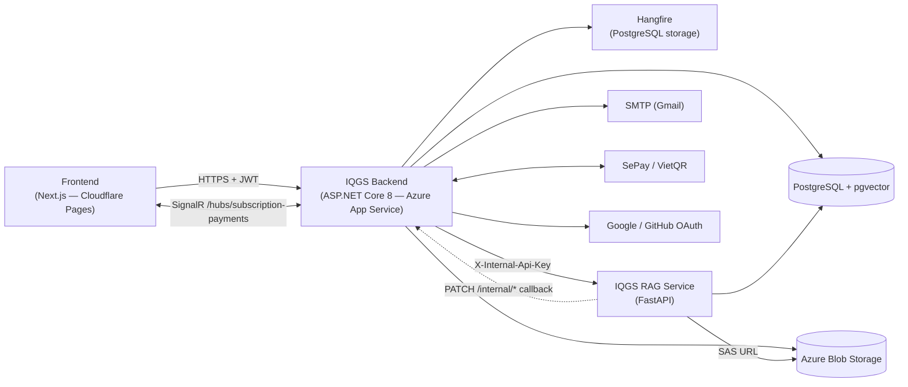
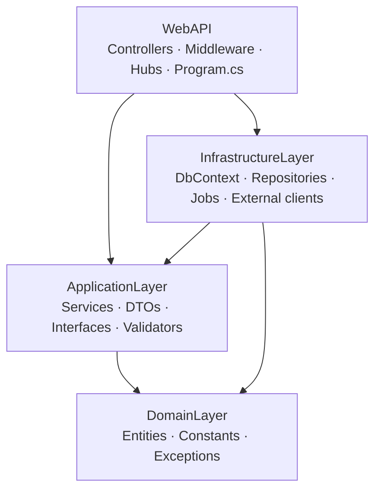
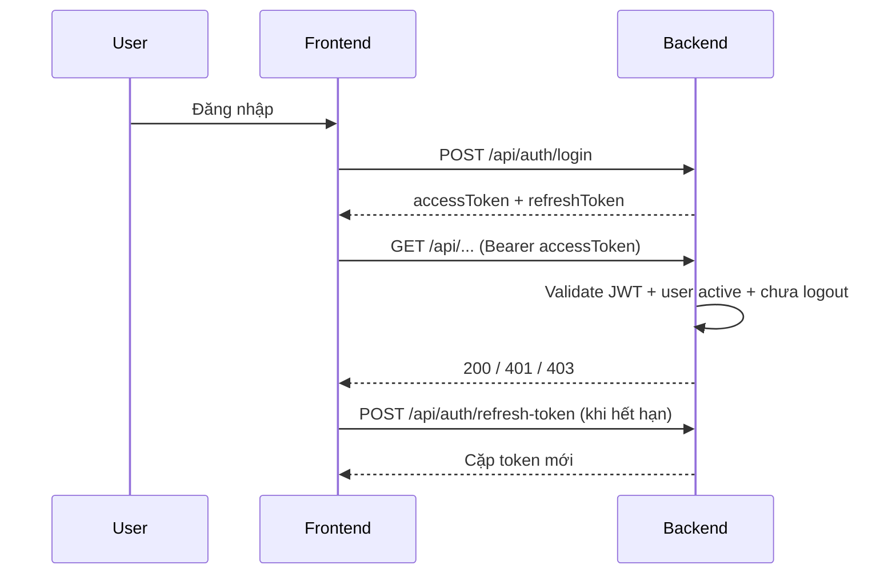
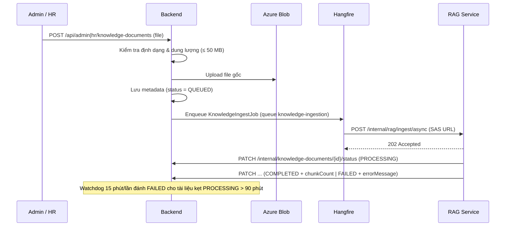
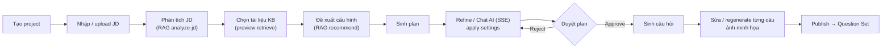
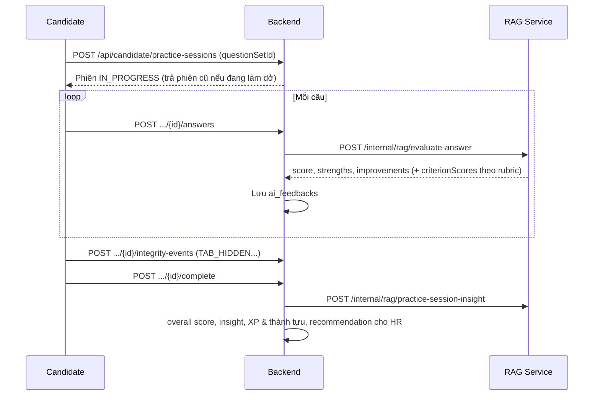
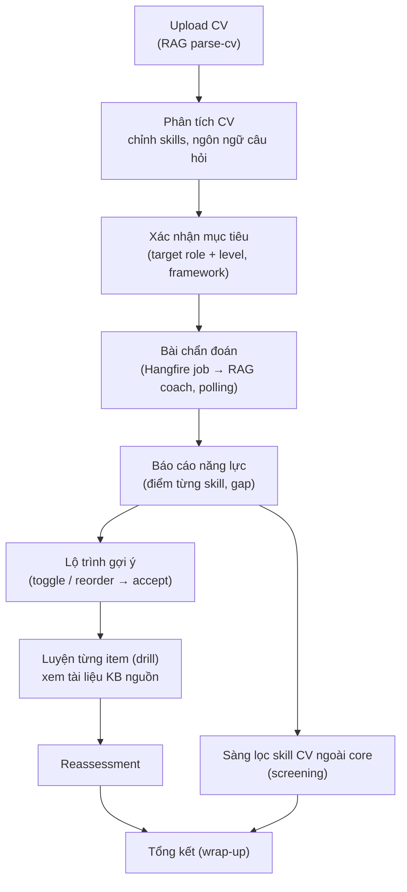
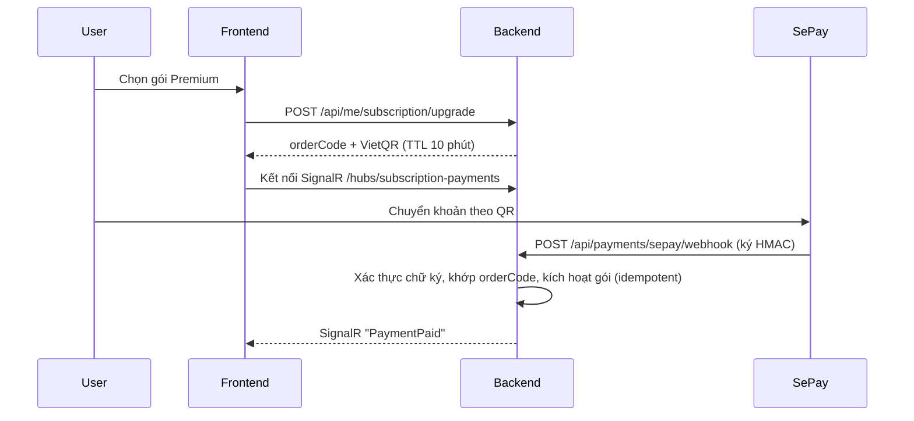
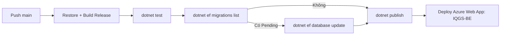

<div align="center">

# IQGS Backend — HireGen AI

**AI-Powered Interview Question Generation System Using RAG and LLM**
*Nền tảng hai phía cho Nhà tuyển dụng (HR) và Ứng viên (Candidate)*

<!-- ===== Nền tảng & framework ===== -->


<!-- ===== Dữ liệu ===== -->


<!-- ===== AI ===== -->


<!-- ===== Xử lý nền & realtime ===== -->


<!-- ===== Bảo mật & tích hợp ===== -->


<!-- ===== Chất lượng, log, test ===== -->


<!-- ===== Hạ tầng / triển khai ===== -->


*Đồ án tốt nghiệp SEP490 — FPT University*

</div>

---

## Mục lục

1. [Tổng quan](#1-tổng-quan)
2. [Tính năng theo vai trò](#2-tính-năng-theo-vai-trò)
3. [Kiến trúc hệ thống](#3-kiến-trúc-hệ-thống)
4. [Tech stack](#4-tech-stack)
5. [Clean Architecture 4 layer](#5-clean-architecture-4-layer)
6. [Cấu trúc thư mục](#6-cấu-trúc-thư-mục)
7. [Cơ sở dữ liệu](#7-cơ-sở-dữ-liệu)
8. [Xác thực & phân quyền](#8-xác-thực--phân-quyền)
9. [Luồng nghiệp vụ chính](#9-luồng-nghiệp-vụ-chính)
10. [Background jobs (Hangfire)](#10-background-jobs-hangfire)
11. [Tích hợp RAG Service](#11-tích-hợp-rag-service)
12. [Subscription & thanh toán SePay](#12-subscription--thanh-toán-sepay)
13. [API Reference](#13-api-reference)
14. [Định dạng response & xử lý lỗi](#14-định-dạng-response--xử-lý-lỗi)
15. [Cấu hình](#15-cấu-hình)
16. [Cài đặt & chạy local](#16-cài-đặt--chạy-local)
17. [Migration](#17-migration)
18. [Kiểm thử](#18-kiểm-thử)
19. [CI/CD & Deploy](#19-cicd--deploy)
20. [Quy ước phát triển](#20-quy-ước-phát-triển)
21. [Troubleshooting](#21-troubleshooting)
22. [Repository liên quan](#22-repository-liên-quan)

---

## 1. Tổng quan

**IQGS Backend** là REST API (ASP.NET Core 8) trung tâm của nền tảng **HireGen AI**. Backend chịu trách nhiệm:

- **Nghiệp vụ & dữ liệu:** người dùng, công ty, bộ câu hỏi, phiên luyện tập, lộ trình học, gói dịch vụ… lưu trên PostgreSQL qua EF Core.
- **Điều phối AI:** gọi **IQGS RAG Service** (FastAPI) để parse JD/CV, sinh plan & câu hỏi, chấm điểm, gợi ý lộ trình. Các tác vụ dài chạy nền bằng **Hangfire**, kết quả được RAG **callback** về `/internal/*` hoặc Backend **polling**.
- **Lưu trữ tệp:** tài liệu tri thức, JD, CV, ảnh câu hỏi trên **Azure Blob Storage**, chia sẻ cho RAG qua SAS URL.
- **Thương mại:** gói Free/Premium, hạn mức sử dụng, thanh toán VietQR qua **SePay**, đẩy trạng thái thanh toán realtime bằng **SignalR**.

| Chỉ số | Giá trị |
|--------|---------|
| Controllers | 53 |
| Endpoints HTTP | **287** |
| Bảng dữ liệu | 58 (prefix `tbl_`) |
| Migrations | 88 |
| Unit / integration test cases | ~380 (`[Fact]` / `[Theory]`) |
| Recurring jobs | 4 |

---

## 2. Tính năng theo vai trò

### Admin

| Nhóm | Chức năng |
|------|-----------|
| Knowledge Base hệ thống | Upload tài liệu SYSTEM (PDF/DOCX/TXT/JSONL), quản lý thư mục, đổi metadata, xem chunk, re-ingest, xóa |
| Competency & Roadmap | Import / validate competency framework, role family, chính sách chấm điểm & quy tắc level, import roadmap node (JSON/JSONL) |
| Marketplace | Thống kê, ghim / bỏ ghim, gỡ bộ câu hỏi khỏi marketplace |
| Người dùng & Công ty | Danh sách, chi tiết, khóa/mở tài khoản, thống kê, quản lý công ty, xử lý feedback |
| Subscription | Tạo/sửa gói, kích hoạt / thu hồi Premium, thống kê doanh thu & giao dịch SePay, hạn mức sử dụng |
| Vận hành AI | Trạng thái RAG, đổi model/provider/temperature/top-K (platform settings, hot-reload sang RAG) |

### HR (Nhà tuyển dụng)

| Nhóm | Chức năng |
|------|-----------|
| **Interview Studio** | Tạo project → nhập/upload JD → AI phân tích JD → đề xuất cấu hình → sinh plan → refine / chat AI (SSE) → duyệt → sinh câu hỏi → regenerate từng câu → publish |
| Knowledge Base riêng | Upload tài liệu scope HR, chọn tài liệu dùng cho project, xem trước nguồn retrieve |
| Bộ câu hỏi | CRUD câu hỏi, sắp xếp, ảnh minh họa, giới hạn thời gian, rubric, publish lên marketplace, export Excel, **JD-fit review** |
| Tuyển dụng | Hiring assessment / hiring posting, thống kê & insight người làm bài, xếp hạng, mời ứng viên, gợi ý ứng viên (shortlist / dismiss / invite / offer), talent pool |
| Dashboard | Thống kê tổng quan, bookmark, mua gói Ask AI |

### Candidate (Ứng viên)

| Nhóm | Chức năng |
|------|-----------|
| CV | Upload CV (PDF/DOCX/ảnh) → AI trích kỹ năng, đồng bộ vào hồ sơ theo tùy chọn |
| Marketplace & luyện tập | Duyệt bộ câu hỏi public, bookmark, làm bài có giới hạn thời gian, chống gian lận (rời tab), chấm điểm AI từng câu, insight tổng phiên |
| Bộ đề cá nhân | Sinh đề luyện tập từ JD (text/file) theo khoảng trống kỹ năng |
| **AI Coach** | Phân tích CV → xác nhận mục tiêu → bài chẩn đoán → báo cáo năng lực → lộ trình học (accept / drill / reassessment) → bài sàng lọc kỹ năng ngoài core → tổng kết |
| Gamification | XP, level, streak, mục tiêu ngày, 8 thành tựu, lịch sử hoạt động |
| Tuyển dụng | Nhận lời mời / offer từ HR, cài đặt quyền riêng tư (cho phép HR thấy hồ sơ) |

---

## 3. Kiến trúc hệ thống



| Thành phần | Vai trò |
|------------|---------|
| **Backend (repo này)** | Auth, nghiệp vụ, persist, điều phối job, phân quyền, hạn mức, thanh toán |
| **RAG Service** | Toàn bộ xử lý AI (parse, embed, retrieve, LLM) — stateless |
| **PostgreSQL** | DB nghiệp vụ + bảng vector `tbl_knowledge_chunks` (RAG đọc/ghi) + Hangfire storage |
| **Azure Blob** | File gốc: tài liệu tri thức, JD, CV, ảnh câu hỏi |
| **SignalR Hub** | Đẩy sự kiện `PaymentPaid` tới FE ngay sau webhook SePay |

---

## 4. Tech stack

| Hạng mục | Công nghệ |
|----------|-----------|
| Runtime | .NET 8, ASP.NET Core Web API |
| ORM / DB | Entity Framework Core 8, Npgsql, **Pgvector.EntityFrameworkCore** |
| Background job | Hangfire 1.8 + Hangfire.PostgreSql (queues: `question-generation`, `knowledge-ingestion`, `default`) |
| Auth | JWT Bearer, BCrypt, Google OAuth (`Google.Apis.Auth`), GitHub OAuth |
| Validation | FluentValidation |
| Logging | Serilog (Console + file `logs/webapi-.log` theo ngày) |
| Realtime | SignalR |
| Storage | Azure.Storage.Blobs |
| Tài liệu | UglyToad.PdfPig, DocumentFormat.OpenXml, ClosedXML (export Excel) |
| Email | MailKit |
| API docs | Swashbuckle (Swagger UI + XML comments) |
| Test | xUnit, Moq, Microsoft.AspNetCore.Mvc.Testing, Testcontainers.PostgreSql |
| CI/CD | GitHub Actions → Azure Web App |

### Vì sao chọn các công nghệ này

| Công nghệ | Vai trò trong hệ thống | Lý do chọn / đánh đổi |
|-----------|------------------------|------------------------|
| **ASP.NET Core 8** | Web API chính, middleware, DI | LTS, hiệu năng cao, DI & pipeline có sẵn; hợp với Clean Architecture |
| **Clean Architecture** | Tách Domain / Application / Infrastructure / WebAPI | Dễ test, đổi hạ tầng (RAG, Blob, SePay) mà không đụng nghiệp vụ; đổi lại nhiều boilerplate |
| **EF Core + Npgsql** | ORM, migration, Fluent API | Code-first, version hóa schema qua migration; đánh đổi: truy vấn phức tạp cần tối ưu thủ công |
| **PostgreSQL + pgvector** | DB nghiệp vụ + lưu vector embedding (768 chiều) | Một DB duy nhất cho dữ liệu & vector, không cần vector DB riêng; đổi lại khó scale vector rất lớn |
| **Hangfire (PostgreSQL storage)** | Job nền: ingest tài liệu, sinh đề Coach, watchdog | Retry + dashboard sẵn, dùng chung Postgres, không cần Redis/queue riêng |
| **SignalR** | Đẩy `PaymentPaid` realtime sau webhook SePay | Tích hợp native ASP.NET, fallback tự động WebSocket/SSE/long-polling |
| **Server-Sent Events** | Stream câu trả lời Chat AI trong Studio | Đơn giản hơn WebSocket cho luồng 1 chiều server → client |
| **JWT + Refresh token** | Xác thực stateless, xoay vòng token | Dễ scale ngang; logout xử lý bằng cách xóa refresh token |
| **Google / GitHub OAuth** | Đăng nhập nhanh | Giảm ma sát đăng ký cho ứng viên |
| **BCrypt** | Băm mật khẩu | Có salt + cost factor, chống brute-force |
| **FluentValidation** | Validate request DTO | Tách rule khỏi controller, dễ unit test |
| **Serilog** | Log có cấu trúc (Console + file theo ngày) | Dễ truy vết lỗi khi deploy |
| **Azure Blob Storage + SAS URL** | Lưu file gốc (KB, JD, CV, ảnh) | Chia sẻ cho RAG bằng URL tạm thời, không lộ connection string |
| **RAG Service (FastAPI)** | Parse, embed, retrieve, gọi LLM, chấm điểm | Tách riêng stack Python (hệ sinh thái AI) khỏi .NET; giao tiếp HTTP + `X-Internal-Api-Key` |
| **SePay / VietQR** | Thanh toán nâng cấp Premium | Phù hợp thị trường VN, webhook ký HMAC, idempotent |
| **MailKit** | Gửi OTP, quên mật khẩu, offer phỏng vấn | Client SMTP hiện đại, hỗ trợ async/TLS |
| **PdfPig / OpenXml / ClosedXML** | Đọc PDF, DOCX; export Excel | Thư viện thuần .NET, không cần cài phần mềm ngoài |
| **Swagger (Swashbuckle)** | Tài liệu & thử API | Sinh từ XML summary, có nút Authorize JWT |
| **xUnit + Moq + Testcontainers** | Unit & integration test | Integration test chạy trên PostgreSQL thật trong container |
| **Docker Compose** | Dựng PostgreSQL local | Môi trường dev đồng nhất |
| **GitHub Actions → Azure App Service** | Build, test, migrate, deploy khi push `main` | Tự động hóa, giảm lỗi triển khai thủ công |
| **Cloudflare Pages + Tunnel** | Host Frontend, public RAG service | Miễn phí, HTTPS sẵn; lưu ý timeout ~100s nên cần cơ chế async + polling |

---

## 5. Clean Architecture 4 layer



| Layer | Trách nhiệm | Quy tắc |
|-------|-------------|---------|
| **DomainLayer** | Entity, hằng số trạng thái, exception nghiệp vụ, Studio entities/enums | Không phụ thuộc layer nào |
| **ApplicationLayer** | Business logic (services), DTO request/response, interface repository/service/job, settings, mapping | Chỉ tham chiếu DomainLayer, **không** import InfrastructureLayer |
| **InfrastructureLayer** | `AppDbContext`, EF configurations, migrations, repositories, Hangfire jobs, `RagService`, Azure Blob, SePay gateway, Studio services | Hiện thực interface của ApplicationLayer |
| **WebAPI** | Controller mỏng (nhận request → gọi service → trả response), middleware, SignalR hub, DI | Không chứa business logic |

---

## 6. Cấu trúc thư mục

```text
IQGS-SEP490-Backend/
├── DomainLayer/
│   ├── Entities/               # User, QuestionSet, PracticeSession, KnowledgeDocument, CandidateRoadmap, Subscription...
│   ├── Constants/              # Trạng thái dạng string: QuestionGenerationJobStatus, KnowledgeDocumentStatus, UserRole...
│   ├── Studio/                 # StudioEntities + StudioEnums (Interview Studio)
│   ├── Exceptions/             # BaseHttpException và các exception nghiệp vụ
│   └── Common/                 # StructuredErrorPayload
├── ApplicationLayer/
│   ├── DTOs/                   # Admin, Auth, Candidate, Coach, Hr, KnowledgeBase, QuestionGeneration, QuestionSet, Rag, Subscription...
│   ├── Interfaces/             # Repositories, Services, Jobs
│   ├── Services/               # Auth, QuestionSet, PracticeSession, Recommendation, Subscription...
│   │   ├── Coach/              # AI Coach: blueprint, screening, scoring, gap analysis, roadmap
│   │   └── Gamification/       # XP, level, streak, achievement rules
│   ├── Studio/                 # Contracts, Interfaces, Validators, Helpers của Interview Studio
│   ├── Settings/               # RagServiceSettings, BlobStorageSettings, SePaySettings, CvSettings...
│   └── Helpers/ · ResponseCode/ · Debugging/
├── InfrastructureLayer/
│   ├── Database/               # AppDbContext, DatabaseSeeder, StudioSeedData
│   ├── Configurations/         # Fluent API config (bao gồm Studio/)
│   ├── Migrations/             # EF Core migrations
│   ├── Repository/             # Repository implementations
│   ├── Jobs/                   # Hangfire jobs + JobScheduler
│   ├── External/               # RagService (HttpClient), AzureBlobStorageService, SePayGateway
│   └── Services/               # Studio (JD analyzer, text extractors, knowledge RAG), Gamification
├── WebAPI/
│   ├── Controllers/            # Admin/ · Hr/ · Studio/ · Candidate/ · Internal/ · Public/ + Auth, Users, Company, Feedback, Subscription
│   ├── Middleware/             # ExceptionHandlingMiddleware, InternalApiKeyMiddleware
│   ├── Hubs/ · Realtime/       # SubscriptionPaymentHub + notifier
│   ├── Program.cs              # DI, auth, Hangfire, Swagger, pipeline
│   └── appsettings.json
├── ApplicationLayer.UnitTests/ # xUnit + Moq: Candidate, Hr, Studio, Knowledge, Subscription, Gamification...
├── WebAPI.IntegrationTests/    # WebApplicationFactory + Testcontainers PostgreSQL
├── docs/features/              # Tài liệu tính năng
├── .github/workflows/deploy-webapi.yml
├── docker-compose.yml
└── IQGS-BE.sln
```

---

## 7. Cơ sở dữ liệu

PostgreSQL 16 + extension `vector`. Toàn bộ bảng dùng prefix `tbl_`, cấu hình bằng EF Core Fluent API.

### 7.1 Nhóm bảng

| Nhóm | Bảng |
|------|------|
| **Người dùng** | `tbl_users`, `tbl_roles`, `tbl_hr_profiles`, `tbl_candidate_profiles`, `tbl_companies` |
| **Knowledge Base** | `tbl_knowledge_documents`, `tbl_knowledge_chunks` (vector 768 — RAG ghi) |
| **Interview Studio** | `tbl_studio_interview_projects`, `tbl_studio_job_descriptions`, `tbl_studio_knowledge_documents`, `tbl_studio_settings`, `tbl_studio_interview_plans`, `tbl_studio_plan_sections`, `tbl_studio_plan_focus_areas`, `tbl_studio_focus_areas`, `tbl_studio_plan_approval_histories`, `tbl_studio_interview_questions`, `tbl_studio_question_generation_runs`, `tbl_studio_ai_chat_sessions`, `tbl_studio_ai_chat_messages`, `tbl_studio_project_shares` |
| **Bộ câu hỏi & Marketplace** | `tbl_question_sets`, `tbl_question_set_questions`, `tbl_question_set_bookmarks`, `tbl_hr_question_set_bookmarks`, `tbl_question_set_feedbacks`, `tbl_question_set_jd_fit_reviews` |
| **Luyện tập** | `tbl_practice_sessions`, `tbl_candidate_answers`, `tbl_ai_feedbacks`, `tbl_candidate_personal_set_jobs` |
| **AI Coach & Competency** | `tbl_competency_frameworks`, `tbl_competency_framework_skills`, `tbl_competency_role_families`, `tbl_competency_role_family_aliases`, `tbl_competency_role_aliases`, `tbl_competency_scoring_policies`, `tbl_competency_level_rules`, `tbl_candidate_assessments`, `tbl_candidate_assessment_skill_results`, `tbl_candidate_skill_plans`, `tbl_candidate_skill_plan_items`, `tbl_candidate_roadmaps`, `tbl_candidate_roadmap_items`, `tbl_roadmap_nodes` |
| **Tuyển dụng** | `tbl_candidate_recommendations`, `tbl_candidate_invitations`, `tbl_candidate_offers` |
| **Gamification** | `tbl_user_progress`, `tbl_xp_transactions`, `tbl_user_achievements`, `tbl_daily_progress` |
| **Subscription** | `tbl_subscription_plans`, `tbl_subscriptions`, `tbl_subscription_transactions`, `tbl_usage_counters` |
| **Hệ thống** | `tbl_platform_settings`, `tbl_feedbacks`, `rag_runtime_settings` (RAG đọc) |

> Các entity của luồng sinh câu hỏi V1 (`QuestionGenerationJob`, `QuestionGenerationPlan`, `GeneratedQuestion`, `QuestionAiChatMessage`) vẫn còn trong code để DTO/service biên dịch được, nhưng đã bị `Ignore` trong `AppDbContext` và bảng đã drop. Luồng hiện tại dùng các bảng `tbl_studio_*`.

### 7.2 Trạng thái quan trọng

| Đối tượng | Giá trị |
|-----------|---------|
| `UserRole` | `Admin`, `HR`, `Candidate` |
| `KnowledgeDocumentStatus` | `QUEUED` → `PROCESSING` → `COMPLETED` / `FAILED` |
| `KnowledgeDocumentScope` | `SYSTEM`, `HR` |
| `KnowledgeDocumentType` | `Policy`, `InternalStack`, `Rubric`, `RolePack`, `Roadmap`, `Unclassified` |
| `QuestionGenerationStatus` (Studio run) | `Pending` → `Generating` → `Completed` / `Failed` / `Cancelled` |
| `InterviewProjectStatus` (Studio) | `Draft`, `Refining`, `AwaitingApproval`, `Approved`, `Generated`, `Archived` |
| `InterviewPlanStatus` (Studio) | `Draft`, `Refining`, `AwaitingApproval`, `Approved`, `Superseded`, `Rejected` |
| `QuestionSetStatus` / `QuestionSetKind` | `DRAFT`, `PUBLISHED` / `Marketplace`, `Personal` |
| `PracticeSessionStatus` | `IN_PROGRESS` → `COMPLETED` / `ABANDONED` |
| `CandidatePersonalSetPurpose` | `JdGap`, `CvDiagnostic`, `CvDrill`, `CvReassessment`, `CvScreening` |
| `CandidatePersonalSetJobStatus` | `QUEUED` → `GENERATING` → `COMPLETED` / `FAILED` |
| `CandidateRecommendationStatus` | `NEW`, `SHORTLISTED`, `DISMISSED`, `INVITED` |
| `InvitationStatus` / `CandidateOfferStatus` | `PENDING`, `ACCEPTED`, `REJECTED` / `SENT`, `ACCEPTED`, `REJECTED` |
| `ExperienceLevel` | `Intern`, `Fresher`, `Junior`, `Middle`, `Senior` |
| Subscription plan | `HR_FREE`, `HR_PREMIUM`, `CANDIDATE_FREE`, `CANDIDATE_PREMIUM` |
| Transaction | `Pending` → `Paid` / `Failed` / `Expired` |

### 7.3 Dữ liệu seed

Khi khởi động, `DatabaseSeeder` tự tạo (nếu chưa có): roles, tài khoản `admin@iqgs.com`, `hr@iqgs.com`, `candidate@iqgs.com`, danh sách công ty mẫu và dữ liệu Studio mẫu. Mật khẩu mặc định nằm trong `InfrastructureLayer/Database/DatabaseSeeder.cs`.

> [!WARNING]
> Đổi mật khẩu các tài khoản seed ngay sau khi deploy lên môi trường thật.

---

## 8. Xác thực & phân quyền

| Cơ chế | Áp dụng cho | Chi tiết |
|--------|-------------|----------|
| **JWT Bearer** | `/api/*` | Header `Authorization: Bearer <token>`. Claim `sub` = userId, role theo `ClaimTypes.Role`. Clock skew 30s |
| **Refresh token** | `/api/auth/refresh-token` | Xoay vòng; logout sẽ xóa refresh token → mọi access token cũ bị từ chối |
| **Kiểm tra trạng thái user** | Mỗi request có JWT | `OnTokenValidated` chặn user bị vô hiệu hóa hoặc đã logout |
| **Role-based** | Controller/action | `[Authorize(Roles = "Admin" / "HR" / "Candidate")]` |
| **Internal API key** | `/internal/*` | Middleware `InternalApiKeyMiddleware` kiểm tra `X-Internal-Api-Key` (dùng cho RAG callback), không dùng JWT |
| **SignalR** | `/hubs/*` | JWT truyền qua query `?access_token=` |
| **OAuth** | Google, GitHub | Bước `verify` để biết user mới/cũ, sau đó login/đăng ký kèm `IntendedRole` |

Bảo mật tài khoản: khóa sau **5** lần đăng nhập sai trong **15** phút, xác minh email bằng OTP 6 chữ số (hết hạn sau 10 phút), quên/đặt lại mật khẩu qua email.



---

## 9. Luồng nghiệp vụ chính

### 9.1 Ingest Knowledge Base



- Admin (SYSTEM): `.pdf .docx .txt .jsonl`. HR (HR scope): `.pdf .docx .txt`.
- Tối đa 3 ingest chạy song song (`KnowledgeBase:MaxConcurrentIngestJobs`).
- Xóa tài liệu: xóa Blob + metadata, sau đó gọi `DELETE /internal/rag/documents/{id}` để dọn chunk.

### 9.2 HR — Interview Studio



- **Plan** được sinh đồng bộ (`RAG /generate-plan`), refine bằng `RAG /refine-plan` (patch delta), đề xuất cấu hình bằng `RAG /recommend-interview-configuration`, khóa nguồn trích dẫn bằng `RAG /bind-outline-sources`.
- **Câu hỏi** được sinh **bất đồng bộ**: Backend tạo `QuestionGenerationRun` (`Pending`) rồi gọi `RAG /generate-questions-from-plan/async` với `jobId = run.Id`. RAG xử lý nền và callback `PATCH /internal/question-generation-jobs/{runId}/generation-result`; Backend nhận diện đây là Studio run và lưu câu hỏi. Lỗi dispatch → run `Failed` với mã `RAG_DISPATCH_FAILED` (HTTP 502).
- Plan có **lịch sử revision** (`Superseded` khi có bản mới) và lịch sử duyệt (`submit-for-approval`, `approve`, `reject`).
- Chat AI trong Studio stream qua **Server-Sent Events** (`GET .../chat/stream`).
- Có thể chia sẻ project bằng share link (`View` / `Edit`), người nhận mở qua `GET /api/studio/shared/{token}`.
- Số lần regenerate plan / câu hỏi bị giới hạn theo gói (`PLAN_REGENERATE_LIMIT`, `QUESTION_REGEN_LIMIT`).

### 9.3 Luồng sinh câu hỏi V1 (đã ngừng)

Luồng cũ `/api/hr/question-generation-jobs/*` và `/api/hr/question-generation-plans/*` (tạo job → duyệt plan → sinh câu hỏi qua Hangfire) **đã retire**, được thay hoàn toàn bằng Interview Studio. Mọi endpoint của 2 controller này trả **`410 Gone`**:

```json
{ "error": "V1_GENERATE_RETIRED", "message": "..." }
```

Các thành phần V1 còn lại trong code (`GeneratePlanJob`, `GenerateQuestionsFromPlanJob`, `QuestionGenerationJobRepository`, watchdog `stuck-question-generation`) chỉ còn để giữ tương thích biên dịch và là no-op.

### 9.4 Bộ câu hỏi, Marketplace & Tuyển dụng

- HR quản lý Question Set: sửa câu, rubric, giới hạn thời gian, ảnh, **JD-fit review** (AI nhận xét bộ đề so với JD), export Excel.
- `publish` đưa bộ câu hỏi lên marketplace (có kiểm tra đáp án mẫu & rubric trước khi publish). Admin có thể ghim hoặc gỡ.
- **Hiring assessment / hiring posting:** biến bộ đề thành bài đánh giá tuyển dụng, kèm JD public.
- **Recommendation:** ứng viên đạt điểm cao (≥ 70), có đồng ý chia sẻ hồ sơ, trên bộ đề PUBLISHED sẽ được đề xuất cho HR → `shortlist` / `dismiss` / `invite` / `offer`. Offer gửi email kèm link public `/api/public/candidate-offers/{token}` để ứng viên xác nhận.
- Insight: thống kê chất lượng bộ câu hỏi, xếp hạng theo số câu đạt trên phiên điểm cao nhất, xem bài làm từng ứng viên.

### 9.5 Candidate — Phiên luyện tập



- Hết giờ → watchdog (mỗi phút) tự nộp bài với `CompletedAt` = deadline.
- Rời tab quá ngưỡng → tự động complete (chống gian lận).
- Mức chấm AI phụ thuộc gói (Premium hoặc lượt Free đầu tiên được feedback đầy đủ).

### 9.6 Candidate — AI Coach



- Competency framework là **dữ liệu** (Admin import), không hardcode stack. Điểm được tính theo `CompetencyScoringPolicy` và `CompetencyLevelRule`.
- Sinh đề Coach dùng `GenerateCandidatePersonalSetJob`; Backend gọi RAG endpoint async và **poll mỗi 3 giây** (tối đa 5 lần lỗi liên tiếp) để tránh timeout ~100s của Cloudflare.
- Có thể hủy job (`jobs/{id}/cancel`), soft-reset vòng Coach (`reset-run`), chấm lại báo cáo (`report/rescore`).

### 9.7 Gamification

Mỗi hoạt động luyện tập sinh XP (`XpRewardPolicy`) → tính level (`LevelCalculator`), streak theo ngày địa phương (`StreakCalculator`), mục tiêu ngày, và 8 thành tựu: First Step, On Fire, Excellent Answer, Dedicated, Technical Mind, System Thinker, Consistency, Interview Veteran.

---

## 10. Background jobs (Hangfire)

Dashboard: `/hangfire` (mặc định chỉ truy cập được từ localhost).

### On-demand jobs

| Job | Queue | Kích hoạt khi |
|-----|-------|---------------|
| `KnowledgeIngestJob` | knowledge-ingestion | Upload / re-ingest tài liệu |
| `GeneratePlanJob`, `GenerateQuestionsFromPlanJob` | question-generation | *Legacy V1 — không còn được gọi* |
| `GenerateCandidatePersonalSetJob` | default | Candidate tạo bộ đề cá nhân, Coach diagnostic / drill / reassessment / screening |

### Recurring jobs

| Job | Cron | Chức năng |
|-----|------|-----------|
| `stuck-knowledge-documents` | `*/15 * * * *` | Đánh FAILED tài liệu kẹt `PROCESSING` > 90 phút |
| `stuck-question-generation` | `*/15 * * * *` | *No-op* (luồng V1 đã retire) |
| `expired-practice-sessions` | `* * * * *` | Tự nộp các phiên luyện tập đã hết giờ |
| `expire-pending-upgrade-orders` | `*/5 * * * *` | Hủy đơn nâng cấp SePay `Pending` quá TTL (10 phút) |

---

## 11. Tích hợp RAG Service

- HttpClient typed: `InfrastructureLayer/External/RagService.cs`, tự gắn header `X-Internal-Api-Key`.
- Repo RAG: [IQGS-SEP490-RAG-LLM-SERVICE](https://github.com/namnm309/IQGS-SEP490-RAG-LLM-SERVICE).

| Nghiệp vụ Backend | Endpoint RAG |
|-------------------|--------------|
| Ingest / xóa tài liệu | `/internal/rag/ingest/async`, `DELETE /internal/rag/documents/{id}` |
| Xem trước nguồn | `/internal/rag/retrieve` |
| JD | `/validate-jd`, `/parse-jd`, `/analyze-jd` |
| Studio / HR | `/recommend-interview-configuration`, `/generate-plan`, `/refine-plan`, `/bind-outline-sources`, `/generate-questions-from-plan/async`, `/evaluate-question-set` |
| CV | `/parse-cv` |
| Luyện tập | `/evaluate-answer`, `/practice-session-insight` |
| Coach | `/candidate/generate-plan`, `/candidate/generate-questions-from-plan[/async]` + polling `jobs/{jobId}`, `/candidate/roadmap-recommendation`, `/candidate/retrieve-competency-context`, `/candidate/generate-adaptive-*` |
| Admin | `/health`, `/models`, `/reload-config` |

**Callback RAG → Backend** (bảo vệ bằng `X-Internal-Api-Key`):

| Endpoint | Payload |
|----------|---------|
| `PATCH /internal/knowledge-documents/{id}/status` | `status`, `chunkCount`, `errorMessage` |
| `PATCH /internal/question-generation-jobs/{jobId}/generation-result` | `phase`, `success`, `questions`, `error` — `jobId` là Studio `QuestionGenerationRun` |

| Cấu hình `RagService` | Mặc định | Ý nghĩa |
|-----------------------|----------|---------|
| `BaseUrl` | `https://iqgsrag.cloud` | URL RAG (Cloudflare Tunnel) |
| `TimeoutSeconds` | 300 | Timeout endpoint đồng bộ |
| `DispatchTimeoutSeconds` | 30 | Timeout khi gọi endpoint `/async` (chỉ chờ 202) và mỗi lần poll |
| `HealthCheckTimeoutSeconds` | 5 | Timeout health check |
| `EmbeddingDimension` | 768 | Phải khớp RAG `EMBEDDING_DIMENSION` |

---

## 12. Subscription & thanh toán SePay



- Gói: `HR_FREE`, `HR_PREMIUM`, `CANDIDATE_FREE`, `CANDIDATE_PREMIUM`. HR có thể mua thêm gói Ask AI (`POST /api/me/packs/ask-ai`).
- Đo lường hạn mức (`UsageMeteringService`) theo feature: `HrGenerateSet`, `HrPlanRegenerate`, `HrQuestionRegen`, `HrAskAi`, `HrExport`, `CandidatePractice`, `CandidatePersonalSet`, `CandidateFeedback`, `CandidateFullAiFeedback`.
- Lỗi chặn theo gói: `QUOTA_EXCEEDED`, `COOLDOWN_ACTIVE`, `PLAN_REGENERATE_LIMIT`, `QUESTION_REGEN_LIMIT`, `FEATURE_REQUIRES_PREMIUM`.
- `SePay:StrictSignatureValidation=true` bắt buộc có `WebhookSecret` (ứng dụng sẽ không khởi động nếu thiếu).

---

## 13. API Reference

- Swagger UI: `https://<host>/swagger` (route `/` tự redirect sang Swagger). Bấm **Authorize** và nhập JWT để thử API.
- JSON dùng camelCase, enum serialize dạng chuỗi, giữ nguyên tiếng Việt (không escape Unicode).
- Ký hiệu quyền: **Public** = không cần đăng nhập · **Đã đăng nhập** = mọi role · **Admin / HR / Candidate** = theo role · **X-Internal-Api-Key** = chỉ RAG.

| Nhóm | Prefix | Số endpoint |
|------|--------|-------------|
| Core (Auth, Users, Company, Feedback, Subscription) | `/api/auth`, `/api/users`, `/api/companies`, `/api/feedbacks`, `/api/plans`, `/api/me`, `/api/payments` | 41 |
| Admin | `/api/admin/*` | 49 |
| HR | `/api/hr/*` | 74 (22 endpoint V1 trả `410 Gone`) |
| Interview Studio | `/api/studio/*` | 57 |
| Candidate | `/api/candidate/*` | 62 |
| Public | `/api/public/*` | 2 |
| Internal (RAG callback) | `/internal/*` | 2 |

> Bấm vào từng controller để xem danh sách endpoint. Bảng được tạo từ mã nguồn controller và XML summary.


### 13.1 Core — Auth, Users, Company, Feedback, Subscription

<details>
<summary><b>AuthController</b> — 13 endpoint</summary>

> SCRUM-154: Đăng nhập + cấp JWT (email/password &amp; Google OAuth) SCRUM-155: Refresh token + giới hạn đăng nhập thất bại + logout SCRUM-157: Quên mật khẩu + đặt lại…

| Method | Endpoint | Quyền | Mô tả |
|---|---|---|---|
| `POST` | `/api/auth/login` | Public | Đăng nhập bằng email và mật khẩu, nhận JWT + refresh token. |
| `POST` | `/api/auth/oauth/google/verify` | Public | Verify Google ID Token để biết user mới hay cũ trước khi tạo account. |
| `POST` | `/api/auth/oauth/google` | Public | Đăng nhập / đăng ký bằng Google OAuth. Với user mới phải kèm IntendedRole + các field profile (CompanyId/CompanyName/JobTitle cho HR;… |
| `POST` | `/api/auth/oauth/github/verify` | Public | Verify GitHub Authorization Code để biết user mới hay cũ trước khi tạo account. |
| `POST` | `/api/auth/oauth/github` | Public | Đăng nhập / đăng ký bằng GitHub OAuth. Với user mới phải kèm IntendedRole + các field profile (CompanyId/CompanyName/JobTitle cho HR;… |
| `POST` | `/api/auth/refresh-token` | Public | Cấp access token mới bằng refresh token (xoay vòng). |
| `POST` | `/api/auth/logout` | Public | Đăng xuất — thu hồi refresh token. |
| `POST` | `/api/auth/register/hr` | Public | Đăng ký tài khoản HR Manager. Gửi email xác minh, chưa cấp JWT. |
| `POST` | `/api/auth/register/candidate` | Public | Đăng ký Candidate — auto-verified, trả JWT ngay (AC-05). |
| `POST` | `/api/auth/verify-email` | Public | Xác minh email bằng mã OTP 6 chữ số (AC-01..03). |
| `POST` | `/api/auth/resend-verification` | Public | Gửi lại email xác minh. Luôn trả success. |
| `POST` | `/api/auth/forgot-password` | Public | Gửi email đặt lại mật khẩu. Luôn trả success bất kể email có tồn tại hay không (AC-02). |
| `POST` | `/api/auth/reset-password` | Public | Đặt lại mật khẩu bằng token nhận được qua email. |

</details>

<details>
<summary><b>CompanyController</b> — 6 endpoint</summary>

> Quản lý danh sách công ty (cho HR chọn khi đăng ký).

| Method | Endpoint | Quyền | Mô tả |
|---|---|---|---|
| `GET` | `/api/companies` | Public | Tìm kiếm công ty theo tên. Public — HR cần tra cứu khi đăng ký. |
| `GET` | `/api/companies/{id}` | Public | Xem chi tiết một công ty. |
| `POST` | `/api/companies` | HR, Admin | Tạo công ty mới (HR/Admin). |
| `POST` | `/api/companies/bulk` | HR, Admin | Tạo nhiều công ty trong 1 request (HR/Admin) — client bấm dấu + thêm nhiều form rồi gửi cả danh sách (tối đa 50). All-or-nothing: 1 phần tử không hợp lệ thì không… |
| `PUT` | `/api/companies/{id}` | HR, Admin | Cập nhật công ty (Admin, hoặc HR thuộc chính công ty đó). |
| `DELETE` | `/api/companies/{id}` | HR, Admin | Xoá (mềm) công ty (Admin, hoặc HR thuộc chính công ty đó). |

</details>

<details>
<summary><b>FeedbackController</b> — 6 endpoint</summary>

> Feedback / đánh giá khách hàng — HR &amp; Candidate gửi, hiển thị công khai trên landing page, Admin duyệt.

| Method | Endpoint | Quyền | Mô tả |
|---|---|---|---|
| `GET` | `/api/feedbacks` | Public | Danh sách feedback đã duyệt — public, dùng cho landing page. |
| `POST` | `/api/feedbacks` | HR, Candidate | Gửi feedback mới (HR/Candidate). Mặc định ở trạng thái chờ duyệt (Pending). |
| `GET` | `/api/feedbacks/admin` | Admin | Danh sách feedback phân trang cho Admin quản lý (tất cả trạng thái). |
| `PUT` | `/api/feedbacks/{id}` | Admin | Admin sửa nội dung/rating của một feedback. |
| `PATCH` | `/api/feedbacks/{id}/status` | Admin | Admin duyệt/từ chối feedback (Pending → Approved/Rejected). |
| `DELETE` | `/api/feedbacks/{id}` | Admin | Admin xoá (mềm) feedback. |

</details>

<details>
<summary><b>SubscriptionController</b> — 9 endpoint</summary>

| Method | Endpoint | Quyền | Mô tả |
|---|---|---|---|
| `GET` | `/api/plans` | Public | Danh sách gói active theo audience (HR / Candidate). |
| `GET` | `/api/me/subscription` | Đã đăng nhập | `GetMySubscription` |
| `GET` | `/api/me/usage` | Đã đăng nhập | `GetMyUsage` |
| `GET` | `/api/me/subscription/payments` | Đã đăng nhập | Lịch sử thanh toán (SubscriptionTransaction Paid/Pending/Failed) của user hiện tại. |
| `POST` | `/api/me/subscription/upgrade` | Đã đăng nhập | Tạo đơn SePay để nâng Premium, chưa nâng ngay. |
| `GET` | `/api/me/subscription/upgrade/{orderCode}` | Đã đăng nhập | `UpgradeStatus` |
| `POST` | `/api/payments/sepay/webhook` | Public | Webhook SePay — public. Đọc raw body để verify HMAC (nếu bật), trả { success: true } theo yêu cầu SePay. |
| `POST` | `/api/me/subscription/cancel` | Đã đăng nhập | `Cancel` |
| `POST` | `/api/me/packs/ask-ai` | HR | Mua pack Ask-AI (sandbox) — cộng Extra trong kỳ hiện tại. |

</details>

<details>
<summary><b>UsersController</b> — 7 endpoint</summary>

| Method | Endpoint | Quyền | Mô tả |
|---|---|---|---|
| `GET` | `/api/users` | Admin | Danh sách user phân trang, tìm kiếm theo tên/email, lọc theo vai trò và trạng thái. |
| `GET` | `/api/users/{id}` | Admin | Chi tiết đầy đủ của một user (chỉ đọc). |
| `PATCH` | `/api/users/{id}/status` | Admin | Vô hiệu hóa hoặc kích hoạt lại tài khoản. |
| `GET` | `/api/users/me` | Đã đăng nhập | Xem hồ sơ của chính mình (kèm thông tin role-specific). |
| `PATCH` | `/api/users/me/hr-profile` | HR | Cập nhật hồ sơ HR Manager. |
| `PATCH` | `/api/users/me/candidate-profile` | Candidate | Cập nhật hồ sơ Candidate. |
| `PATCH` | `/api/users/me/password` | Đã đăng nhập | Đổi mật khẩu — yêu cầu xác nhận mật khẩu hiện tại. |

</details>

### 13.2 Admin

<details>
<summary><b>AdminCompanyController</b> — 1 endpoint</summary>

> SCRUM-480: Admin liệt kê công ty có phân trang (public /api/companies giữ limit 50 cho HR register).

| Method | Endpoint | Quyền | Mô tả |
|---|---|---|---|
| `GET` | `/api/admin/companies` | Admin | Danh sách công ty active — page, pageSize, keyword → { items, totalCount, page, pageSize }. |

</details>

<details>
<summary><b>AdminCompetencyFrameworkController</b> — 4 endpoint</summary>

> SCRUM-453: quản trị competency framework bằng DATA. Thêm role/technology mới (Java, Python, React...) chỉ cần import JSON curated qua đây.

| Method | Endpoint | Quyền | Mô tả |
|---|---|---|---|
| `GET` | `/api/admin/competency-frameworks` | Admin | `List` |
| `POST` | `/api/admin/competency-frameworks/validate` | Admin | Dry-run: báo lỗi/cảnh báo trước khi ghi DB. |
| `POST` | `/api/admin/competency-frameworks/import` | Admin | Upsert idempotent theo (roleKey, level) — chạy lại cùng file không tạo bản trùng. |
| `PATCH` | `/api/admin/competency-frameworks/{id}/status` | Admin | `UpdateStatus` |

</details>

<details>
<summary><b>AdminCompetencyPolicyController</b> — 4 endpoint</summary>

> SCRUM-453/454: tinh chỉnh scoring policy + level rules toàn cục. Không gắn role/technology — .NET/Java/Python/React dùng chung một bộ ngưỡng.

| Method | Endpoint | Quyền | Mô tả |
|---|---|---|---|
| `GET` | `/api/admin/competency-policies/scoring` | Admin | `GetScoring` |
| `PUT` | `/api/admin/competency-policies/scoring` | Admin | `UpdateScoring` |
| `GET` | `/api/admin/competency-policies/level-rules` | Admin | `ListLevelRules` |
| `PUT` | `/api/admin/competency-policies/level-rules` | Admin | `UpdateLevelRules` |

</details>

<details>
<summary><b>AdminCompetencyRoleFamilyController</b> — 2 endpoint</summary>

> SCRUM-457: Role Family + alias là config — thêm domain SE không sửa resolver.

| Method | Endpoint | Quyền | Mô tả |
|---|---|---|---|
| `GET` | `/api/admin/competency-role-families` | Admin | `List` |
| `PUT` | `/api/admin/competency-role-families` | Admin | `Upsert` |

</details>

<details>
<summary><b>AdminKnowledgeDocumentsController</b> — 10 endpoint</summary>

| Method | Endpoint | Quyền | Mô tả |
|---|---|---|---|
| `POST` | `/api/admin/knowledge-documents` | Admin | Upload tài liệu SYSTEM — chọn type (InternalStack/Roadmap/...). |
| `GET` | `/api/admin/knowledge-documents` | Admin | `List` |
| `GET` | `/api/admin/knowledge-documents/folders` | Admin | SCRUM-450: danh sách folder UI + số lượng file. |
| `POST` | `/api/admin/knowledge-documents/folders/rename` | Admin | SCRUM-451: đổi tên folder (metadata bulk, không move Blob). |
| `POST` | `/api/admin/knowledge-documents/move` | Admin | SCRUM-451: chuyển nhiều document sang folder. |
| `GET` | `/api/admin/knowledge-documents/{id}` | Admin | `GetById` |
| `PATCH` | `/api/admin/knowledge-documents/{id}` | Admin | SCRUM-447/450/486: PATCH type + AdminNote + Folder + AllowCandidateView. |
| `GET` | `/api/admin/knowledge-documents/{id}/chunks` | Admin | SCRUM-444/447: preview vài chunk đầu. |
| `POST` | `/api/admin/knowledge-documents/{id}/reingest` | Admin | `Reingest` |
| `DELETE` | `/api/admin/knowledge-documents/{id}` | Admin | `Delete` |

</details>

<details>
<summary><b>AdminMarketplaceController</b> — 6 endpoint</summary>

> SCRUM-404: Admin quản lý Marketplace — list/detail/pin + KPI.

| Method | Endpoint | Quyền | Mô tả |
|---|---|---|---|
| `GET` | `/api/admin/marketplace/stats` | Admin | KPI Marketplace: tổng published, practice 7 ngày, số pin, top HR/skill. |
| `GET` | `/api/admin/marketplace/question-sets` | Admin | Danh sách bộ PUBLISHED trên Marketplace kèm HR owner + practice stats. |
| `GET` | `/api/admin/marketplace/question-sets/{id}` | Admin | Chi tiết bộ + practitioners (Admin không lọc consent). |
| `POST` | `/api/admin/marketplace/question-sets/{id}/pin` | Admin | Ghim bộ lên đầu Marketplace (giới hạn MaxPinnedSets). |
| `DELETE` | `/api/admin/marketplace/question-sets/{id}/pin` | Admin | Bỏ ghim bộ khỏi đầu Marketplace. |
| `POST` | `/api/admin/marketplace/question-sets/{id}/unpublish` | Admin | UC65: Admin gỡ bộ khỏi Marketplace (PUBLISHED → DRAFT), không cần là owner HR. |

</details>

<details>
<summary><b>AdminPlatformSettingsController</b> — 2 endpoint</summary>

> Cấu hình toàn hệ thống do Admin chỉnh runtime — không cần sửa appsettings.json hay redeploy.

| Method | Endpoint | Quyền | Mô tả |
|---|---|---|---|
| `GET` | `/api/admin/platform-settings` | Admin | Xem cấu hình hệ thống hiện tại (vd số câu hỏi tối thiểu để HR publish bộ câu hỏi lên marketplace). |
| `PUT` | `/api/admin/platform-settings` | Admin | Chỉnh cấu hình hệ thống — vd hạ số câu hỏi tối thiểu để publish xuống 1 để tiện test trên web, không cần sửa code/redeploy. |

</details>

<details>
<summary><b>AdminRagStatusController</b> — 1 endpoint</summary>

| Method | Endpoint | Quyền | Mô tả |
|---|---|---|---|
| `GET` | `/api/admin/rag/status` | Admin | Kiểm tra tình trạng dịch vụ RAG (kết nối, cấu hình, database vector). |

</details>

<details>
<summary><b>AdminRoadmapNodeController</b> — 6 endpoint</summary>

> SCRUM-455/486: import curated roadmap nodes + gắn KnowledgeDocument.

| Method | Endpoint | Quyền | Mô tả |
|---|---|---|---|
| `GET` | `/api/admin/roadmap-nodes` | Admin | `List` |
| `POST` | `/api/admin/roadmap-nodes/import` | Admin | `Import` |
| `POST` | `/api/admin/roadmap-nodes/import-jsonl` | Admin | Import JSONL (mỗi dòng 1 node) — cùng schema với docs/kb-seed/roadmap/*.jsonl. |
| `PATCH` | `/api/admin/roadmap-nodes/{id}` | Admin | SCRUM-486: gắn/gỡ KnowledgeDocumentId. |
| `POST` | `/api/admin/roadmap-nodes/link-by-filename` | Admin | SCRUM-486: gắn doc vào nodes có SourceUrl khớp FileName. |
| `DELETE` | `/api/admin/roadmap-nodes/{id}` | Admin | `Delete` |

</details>

<details>
<summary><b>AdminSubscriptionPlansController</b> — 12 endpoint</summary>

> Admin quản lý template gói + gán Premium user + stats SePay (SCRUM-385/386).

| Method | Endpoint | Quyền | Mô tả |
|---|---|---|---|
| `GET` | `/api/admin/plans` | Admin | `List` |
| `POST` | `/api/admin/plans` | Admin | `Create` |
| `PUT` | `/api/admin/plans/{id}` | Admin | Cập nhật template gói. Limits mới áp dụng từ kỳ tiếp theo cho subscriber đang active. |
| `GET` | `/api/admin/users/{userId}/usage` | Admin | `GetUserUsage` |
| `GET` | `/api/admin/users/{userId}/subscription` | Admin | SCRUM-386: xem subscription (EnsureCurrentPeriod — hết hạn Premium tự Free). |
| `POST` | `/api/admin/users/{userId}/subscription/activate-premium` | Admin | Admin gán Premium + reset kỳ (1/3/6/12 tháng). Hết PeriodEnd → Free. |
| `PUT` | `/api/admin/users/{userId}/subscription` | Admin | Gia hạn / reset kỳ khi user đang Premium. |
| `POST` | `/api/admin/users/{userId}/subscription/revoke` | Admin | Thu hồi Premium → Free ngay. |
| `GET` | `/api/admin/usage/summary` | Admin | `GetUsageSummary` |
| `GET` | `/api/admin/subscription/stats` | Admin | KPI doanh thu / Premium / conversion từ DB nội bộ. |
| `GET` | `/api/admin/subscription/transactions` | Admin | Giao dịch subscription gần đây (kèm user/plan). |
| `GET` | `/api/admin/subscription/sepay-overview` | Admin | Overview trực quan từ SePay User API v2 + khớp đơn local. |

</details>

<details>
<summary><b>AdminUsersController</b> — 1 endpoint</summary>

> SCRUM-480: thống kê user Admin (list vẫn ở GET /api/users).

| Method | Endpoint | Quyền | Mô tả |
|---|---|---|---|
| `GET` | `/api/admin/users/stats` | Admin | Đếm user theo vai trò (Admin/HR/Candidate) và trạng thái (Active/Pending/Suspended). |

</details>

### 13.3 HR

<details>
<summary><b>HrBookmarksController</b> — 1 endpoint</summary>

> SCRUM-324: bộ câu hỏi HR đã bookmark (của chính mình) — để mở lại nhanh các set quan trọng.

| Method | Endpoint | Quyền | Mô tả |
|---|---|---|---|
| `GET` | `/api/hr/bookmarks` | HR | Danh sách bộ câu hỏi HR hiện tại đã bookmark, mới nhất trước. |

</details>

<details>
<summary><b>HrCandidatesController</b> — 1 endpoint</summary>

> SCRUM-398: HR xem overview ứng viên (profile + stats + practice trên bộ của mình).

| Method | Endpoint | Quyền | Mô tả |
|---|---|---|---|
| `GET` | `/api/hr/candidates/{candidateUserId}/overview` | HR | Overview ứng viên: profile, stats COMPLETED toàn hệ thống, achievements, danh sách session trên set của HR. Yêu cầu: candidate bật AllowRecruiterRecommendation và đã… |

</details>

<details>
<summary><b>HrDashboardController</b> — 1 endpoint</summary>

> SCRUM-339: dashboard tổng hợp cho HR — gộp KPI, hoạt động theo ngày, phân bố loại câu hỏi, phiên gần đây, phân tích AI và candidate nổi bật vào 1 API duy nhất.

| Method | Endpoint | Quyền | Mô tả |
|---|---|---|---|
| `GET` | `/api/hr/dashboard` | HR | Toàn bộ dữ liệu dashboard của HR hiện tại trong 1 request duy nhất. |

</details>

<details>
<summary><b>HrKnowledgeDocumentsController</b> — 7 endpoint</summary>

| Method | Endpoint | Quyền | Mô tả |
|---|---|---|---|
| `POST` | `/api/hr/knowledge-documents` | HR | `Upload` |
| `GET` | `/api/hr/knowledge-documents` | HR | `List` |
| `GET` | `/api/hr/knowledge-documents/{id}` | HR | `GetById` |
| `PATCH` | `/api/hr/knowledge-documents/{id}` | HR | SCRUM-442: đổi loại tài liệu (Policy / InternalStack / Rubric / RolePack). |
| `GET` | `/api/hr/knowledge-documents/{id}/chunks` | HR | SCRUM-444: preview vài chunk đầu. |
| `POST` | `/api/hr/knowledge-documents/{id}/reingest` | HR | `Reingest` |
| `DELETE` | `/api/hr/knowledge-documents/{id}` | HR | `Delete` |

</details>

<details>
<summary><b>HrPlatformFlagsController</b> — 1 endpoint</summary>

> SCRUM-464: cờ nền tảng đọc-only cho HR (anti-cheat + min câu publish).

| Method | Endpoint | Quyền | Mô tả |
|---|---|---|---|
| `GET` | `/api/hr/platform-flags` | HR | Cờ nền tảng đọc-only cho HR (không dùng admin API). Gồm anti-cheat + số câu tối thiểu để publish (Admin cấu hình runtime). |

</details>

<details>
<summary><b>HrPracticeSessionsController</b> — 1 endpoint</summary>

| Method | Endpoint | Quyền | Mô tả |
|---|---|---|---|
| `GET` | `/api/hr/practice-sessions/{sessionId}/feedback` | HR | AI feedback phiên luyện tập trên bộ của HR — không áp dụng teaser Free của candidate. 403 nếu không phải chủ bộ / candidate tắt consent. 400 nếu phiên chưa COMPLETED. |

</details>

<details>
<summary><b>HrQuestionGenerationJobsController</b> — 18 endpoint · ⚠️ retired</summary>


> Luồng V1 đã retire — dùng Interview Studio `/api/studio/projects`.

| Method | Endpoint | Quyền | Mô tả |
|---|---|---|---|
| `POST` | `/api/hr/question-generation-jobs/plan` | HR | **410 Gone** — V1 đã retire |
| `POST` | `/api/hr/question-generation-jobs/plan/upload` | HR | **410 Gone** — V1 đã retire |
| `GET` | `/api/hr/question-generation-jobs` | HR | **410 Gone** — V1 đã retire |
| `GET` | `/api/hr/question-generation-jobs/{jobId}` | HR | **410 Gone** — V1 đã retire |
| `POST` | `/api/hr/question-generation-jobs/{jobId}/approve-plan` | HR | **410 Gone** — V1 đã retire |
| `POST` | `/api/hr/question-generation-jobs/{jobId}/retry-plan` | HR | **410 Gone** — V1 đã retire |
| `POST` | `/api/hr/question-generation-jobs/{jobId}/retry-questions` | HR | **410 Gone** — V1 đã retire |
| `PUT` | `/api/hr/question-generation-jobs/{jobId}/plan` | HR | **410 Gone** — V1 đã retire |
| `PUT` | `/api/hr/question-generation-jobs/{jobId}/input` | HR | **410 Gone** — V1 đã retire |
| `PUT` | `/api/hr/question-generation-jobs/{jobId}/input/upload` | HR | **410 Gone** — V1 đã retire |
| `GET` | `/api/hr/question-generation-jobs/{jobId}/questions` | HR | **410 Gone** — V1 đã retire |
| `POST` | `/api/hr/question-generation-jobs/{jobId}/questions` | HR | **410 Gone** — V1 đã retire |
| `PUT` | `/api/hr/question-generation-jobs/{jobId}/questions/{questionId}` | HR | **410 Gone** — V1 đã retire |
| `DELETE` | `/api/hr/question-generation-jobs/{jobId}/questions/{questionId}` | HR | **410 Gone** — V1 đã retire |
| `PUT` | `/api/hr/question-generation-jobs/{jobId}/questions/reorder` | HR | **410 Gone** — V1 đã retire |
| `POST` | `/api/hr/question-generation-jobs/{jobId}/save-draft` | HR | **410 Gone** — V1 đã retire |
| `POST` | `/api/hr/question-generation-jobs/{jobId}/questions/{questionId}/ask-ai` | HR | **410 Gone** — V1 đã retire |
| `GET` | `/api/hr/question-generation-jobs/{jobId}/questions/{questionId}/ai-chat` | HR | **410 Gone** — V1 đã retire |

</details>

<details>
<summary><b>HrQuestionGenerationPlansController</b> — 4 endpoint · ⚠️ retired</summary>


> Luồng V1 đã retire — dùng Interview Studio `/api/studio/projects`.

| Method | Endpoint | Quyền | Mô tả |
|---|---|---|---|
| `GET` | `/api/hr/question-generation-plans` | HR | **410 Gone** — V1 đã retire |
| `GET` | `/api/hr/question-generation-plans/{jobId}` | HR | **410 Gone** — V1 đã retire |
| `GET` | `/api/hr/question-generation-plans/{jobId}/questions/export` | HR | **410 Gone** — V1 đã retire |
| `DELETE` | `/api/hr/question-generation-plans/{jobId}` | HR | **410 Gone** — V1 đã retire |

</details>

<details>
<summary><b>HrQuestionSetsController</b> — 29 endpoint</summary>

> Quản lý bộ câu hỏi của HR (draft đã lưu từ session sinh câu hỏi): xem, sửa từng câu, publish/unpublish lên marketplace. Yêu cầu role HR.

| Method | Endpoint | Quyền | Mô tả |
|---|---|---|---|
| `GET` | `/api/hr/question-sets` | HR | Danh sách tất cả bộ câu hỏi (draft/published) mà HR hiện tại sở hữu. |
| `POST` | `/api/hr/question-sets` | HR | SCRUM-397: tạo bộ câu hỏi DRAFT rỗng từ Question Builder (chưa cần Studio Generate). |
| `GET` | `/api/hr/question-sets/{id}` | HR | Chi tiết 1 bộ câu hỏi kèm toàn bộ câu hỏi (có sampleAnswer/evaluationCriteria — chỉ HR chủ sở hữu mới xem được). |
| `PUT` | `/api/hr/question-sets/{questionSetId}/questions/{questionId}` | HR | Sửa nội dung 1 câu hỏi trong bộ (câu hỏi, loại, độ khó, skill, sample answer...). Không sửa được khi bộ đang PUBLISHED — phải unpublish trước. |
| `POST` | `/api/hr/question-sets/{questionSetId}/questions` | HR | Thêm 1 câu hỏi mới vào bộ. Không thêm được khi bộ đang PUBLISHED — phải unpublish trước. |
| `DELETE` | `/api/hr/question-sets/{questionSetId}/questions/{questionId}` | HR | Xóa 1 câu hỏi khỏi bộ (không xóa được câu cuối cùng). Không xóa được khi bộ đang PUBLISHED — phải unpublish trước. |
| `PUT` | `/api/hr/question-sets/{questionSetId}/questions/reorder` | HR | Sắp xếp lại thứ tự câu hỏi trong bộ — truyền đủ danh sách (questionId, order) cho toàn bộ câu hỏi hiện có. |
| `PUT` | `/api/hr/question-sets/{id}/time-limit` | HR | Đặt giới hạn thời gian làm bài practice cho bộ câu hỏi (1–480 phút, truyền null để bỏ giới hạn). Candidate hết giờ sẽ bị tự động nộp bài. Không đổi được khi bộ đang… |
| `PUT` | `/api/hr/question-sets/{id}/recommendation-settings` | HR | SCRUM-424: cấu hình auto gợi ý ứng viên (bật/tắt + ngưỡng điểm 50–95). Được sửa khi PUBLISHED — chỉ ảnh hưởng phiên hoàn thành sau này. |
| `PUT` | `/api/hr/question-sets/{id}/hiring-assessment` | HR | SCRUM-464: Practice vs Tuyển + anti-cheat HR. Được sửa khi PUBLISHED — chỉ ảnh hưởng phiên mới. |
| `PUT` | `/api/hr/question-sets/{id}/public-job-description` | HR | SCRUM-465: bản JD ngắn hiện cho candidate (bộ Tuyển). Được sửa khi PUBLISHED. |
| `PUT` | `/api/hr/question-sets/{id}/hiring-posting` | HR | SCRUM-468: metadata tin tuyển (location / salary / expertise / domain). |
| `PUT` | `/api/hr/question-sets/{id}/title` | HR | Đổi tên bộ câu hỏi (SCRUM-330) — không ảnh hưởng trạng thái DRAFT/PUBLISHED hiện tại. Marketplace/danh sách sẽ phản ánh tên mới ngay. |
| `GET` | `/api/hr/question-sets/{id}/practitioners` | HR | Danh sách candidate đã practice / làm bài trên bộ (SCRUM-326 / SCRUM-471). Bộ Tuyển mặc định chỉ official (+ IN_PROGRESS); includePractice=true trả thêm phiên luyện.… |
| `GET` | `/api/hr/question-sets/{id}/insights` | HR | SCRUM-513: thống kê bộ câu hỏi — câu đạt/trượt, leaderboard, phiên gần đây. Bộ Tuyển mặc định chỉ official; includePractice=true gộp thêm luyện. |
| `POST` | `/api/hr/question-sets/{id}/practitioners/{candidateUserId}/invite` | HR | Mời ứng viên từ practitioners — tạo recommendation nếu chưa có, không yêu cầu điểm ≥ 70. |
| `GET` | `/api/hr/question-sets/{id}/feedback` | HR | Danh sách feedback (rating + nhận xét) candidate đã gửi cho bộ câu hỏi này, kèm rating trung bình. Chỉ HR chủ sở hữu xem được. |
| `POST` | `/api/hr/question-sets/{id}/bookmark` | HR | Bookmark/bỏ bookmark bộ câu hỏi của chính mình (SCRUM-324) — toggle: gọi lần 1 để bookmark, gọi lại để bỏ. Chỉ bookmark được set do chính HR này sở hữu (draft hoặc… |
| `POST` | `/api/hr/question-sets/{id}/publish` | HR | Publish bộ câu hỏi lên marketplace (DRAFT → PUBLISHED). SCRUM-439: body chọn câu + time limit. |
| `GET` | `/api/hr/question-sets/published-overview` | HR | SCRUM-438: tổng hợp set đã publish (practice + rating). |
| `POST` | `/api/hr/question-sets/{id}/unpublish` | HR | Gỡ bộ câu hỏi khỏi marketplace (PUBLISHED → DRAFT) — Candidate sẽ không còn thấy/tìm được bộ này nữa. |
| `POST` | `/api/hr/question-sets/{questionSetId}/questions/{questionId}/image` | HR | SCRUM-396: HR upload ảnh đính kèm câu hỏi trong bộ (History). |
| `DELETE` | `/api/hr/question-sets/{questionSetId}/questions/{questionId}/image` | HR | SCRUM-396: xóa ảnh đính kèm câu hỏi trong bộ. |
| `GET` | `/api/hr/question-sets/{id}/export` | HR | SCRUM-391: xuất Excel bộ câu hỏi (cần quyền CanExport trên gói subscription). |
| `DELETE` | `/api/hr/question-sets/{id}` | HR | SCRUM-391: soft-delete bộ câu hỏi khỏi History (unpublish nếu đang PUBLISHED). |
| `PUT` | `/api/hr/question-sets/{id}/job-description` | HR | Gắn/cập nhật JD bằng text — dùng cho JD Fit khi bộ chưa có JD. |
| `POST` | `/api/hr/question-sets/{id}/job-description` | HR | Gắn/cập nhật JD từ file PDF/DOCX/TXT (parse RAG). |
| `GET` | `/api/hr/question-sets/{id}/jd-fit-review` | HR | Đọc bản đánh giá JD đã lưu — không gọi RAG, không trừ quota. |
| `POST` | `/api/hr/question-sets/{id}/jd-fit-review` | HR | Đánh giá bộ câu hỏi so với JD — nhận xét lời, upsert bảng 1–1, tính quota Ask AI. |

</details>

<details>
<summary><b>HrRecommendationsController</b> — 10 endpoint</summary>

> Dashboard recommendation của HR (SCRUM-291 / SCRUM-328): xem candidate được hệ thống đề xuất theo rule (điểm ≥ 70, có consent, bộ PUBLISHED), shortlist/dismiss/gửi…

| Method | Endpoint | Quyền | Mô tả |
|---|---|---|---|
| `GET` | `/api/hr/recommendations` | HR | Danh sách candidate được đề xuất cho HR hiện tại. Filter: status, questionSetId, minScore. Sort: sortBy=score/date, sortDir=asc/desc. Phân trang page/pageSize. Kèm… |
| `GET` | `/api/hr/recommendations/compare` | HR | `Compare` |
| `GET` | `/api/hr/recommendations/{id}` | HR | Chi tiết 1 recommendation thuộc HR hiện tại — kèm profile/CV/social/practice stats (SCRUM-377). 404 nếu không tồn tại; 403 nếu thuộc HR khác. |
| `GET` | `/api/hr/recommendations/{id}/cv` | HR | Tải CV của candidate thuộc recommendation — trả SAS downloadUrl tạm thời (SCRUM-377). 404 nếu chưa upload CV; 403 nếu recommendation thuộc HR khác. |
| `POST` | `/api/hr/recommendations/{id}/shortlist` | HR | Shortlist 1 recommendation (đánh dấu quan tâm). 409 nếu đã gửi lời mời. |
| `POST` | `/api/hr/recommendations/{id}/dismiss` | HR | Dismiss 1 recommendation (bỏ qua — không hiện trong tab NEW/SHORTLISTED nữa). 409 nếu đã gửi lời mời. |
| `POST` | `/api/hr/recommendations/{id}/invite` | HR | Gửi lời mời phỏng vấn cho candidate từ recommendation (kèm lời nhắn tùy chọn) — candidate sẽ thấy trong GET /api/candidate/invitations. Mỗi recommendation chỉ mời… |
| `POST` | `/api/hr/recommendations/{id}/view` | HR | `MarkViewed` |
| `POST` | `/api/hr/recommendations/{id}/restore` | HR | `Restore` |
| `POST` | `/api/hr/recommendations/{id}/offer` | HR | Gửi email đề nghị phỏng vấn cho candidate từ recommendation — nội dung tự do HR nhập, kèm nút xem/xác nhận dẫn tới trang công khai. Nếu recommendation chưa có lời mời… |

</details>

<details>
<summary><b>HrTalentController</b> — 1 endpoint</summary>

| Method | Endpoint | Quyền | Mô tả |
|---|---|---|---|
| `GET` | `/api/hr/talent` | HR | Talent pool: mọi phiên luyện trên bộ của HR (consent bật), paging server-side. |

</details>

### 13.4 Interview Studio

<details>
<summary><b>StudioAiChatController</b> — 4 endpoint</summary>

| Method | Endpoint | Quyền | Mô tả |
|---|---|---|---|
| `POST` | `/api/studio/projects/{projectId}/chat/messages` | HR | `Send` |
| `GET` | `/api/studio/projects/{projectId}/chat/session` | HR | `GetSession` |
| `GET` | `/api/studio/projects/{projectId}/chat/messages` | HR | `GetMessages` |
| `GET` | `/api/studio/projects/{projectId}/chat/stream` | HR | `Stream` |

</details>

<details>
<summary><b>StudioInterviewPlansController</b> — 11 endpoint</summary>

| Method | Endpoint | Quyền | Mô tả |
|---|---|---|---|
| `POST` | `/api/studio/projects/{projectId}/plans/generate` | HR | `Generate` |
| `GET` | `/api/studio/projects/{projectId}/plans` | HR | `List` |
| `GET` | `/api/studio/projects/{projectId}/plans/current` | HR | `Current` |
| `GET` | `/api/studio/projects/{projectId}/plans/{planId}` | HR | `Detail` |
| `POST` | `/api/studio/projects/{projectId}/plans/{planId}/approve` | HR | `Approve` |
| `PUT` | `/api/studio/projects/{projectId}/plans/{planId}/title` | HR | SCRUM-393: Đổi tiêu đề plan (tên công việc) sau khi đã generate. |
| `POST` | `/api/studio/projects/{projectId}/plans/{planId}/refine` | HR | `Refine` |
| `POST` | `/api/studio/projects/{projectId}/plans/{planId}/apply-settings` | HR | SCRUM-370: Áp dụng quick controls Studio → refine plan (không cần chat). |
| `GET` | `/api/studio/projects/{projectId}/plans/{planId}/history` | HR | `History` |
| `POST` | `/api/studio/projects/{projectId}/plans/{planId}/submit-for-approval` | HR | `SubmitForApproval` |
| `POST` | `/api/studio/projects/{projectId}/plans/{planId}/reject` | HR | `Reject` |

</details>

<details>
<summary><b>StudioInterviewProjectsController</b> — 7 endpoint</summary>

| Method | Endpoint | Quyền | Mô tả |
|---|---|---|---|
| `POST` | `/api/studio/projects` | HR | `Create` |
| `GET` | `/api/studio/projects` | HR | `GetMyProjects` |
| `GET` | `/api/studio/projects/{projectId}` | HR | `Get` |
| `PUT` | `/api/studio/projects/{projectId}` | HR | `Update` |
| `DELETE` | `/api/studio/projects/{projectId}` | HR | `Delete` |
| `POST` | `/api/studio/projects/{projectId}/publish` | HR | SCRUM-439: body chọn interviewQuestionIds + timeLimitMinutes. |
| `POST` | `/api/studio/projects/{projectId}/unpublish` | HR | `Unpublish` |

</details>

<details>
<summary><b>StudioInterviewQuestionsController</b> — 9 endpoint</summary>

| Method | Endpoint | Quyền | Mô tả |
|---|---|---|---|
| `POST` | `/api/studio/projects/{projectId}/questions/generate` | HR | SCRUM-371: nhận GenerationRun (Generating); câu hỏi về sau qua RAG callback. |
| `GET` | `/api/studio/projects/{projectId}/questions` | HR | `List` |
| `PUT` | `/api/studio/projects/{projectId}/questions/{questionId}` | HR | `Update` |
| `DELETE` | `/api/studio/projects/{projectId}/questions/{questionId}` | HR | `Delete` |
| `POST` | `/api/studio/projects/{projectId}/questions/{questionId}/regenerate` | HR | SCRUM-429: enqueue regen nền — trả GenerationRun để FE poll. |
| `POST` | `/api/studio/projects/{projectId}/questions/{questionId}/image` | HR | SCRUM-396: HR upload ảnh đính kèm câu hỏi (Azure Blob). |
| `DELETE` | `/api/studio/projects/{projectId}/questions/{questionId}/image` | HR | SCRUM-396: xóa ảnh đính kèm câu hỏi. |
| `GET` | `/api/studio/projects/{projectId}/question-generation-runs` | HR | `Runs` |
| `GET` | `/api/studio/projects/{projectId}/question-generation-runs/{runId}` | HR | `RunDetail` |

</details>

<details>
<summary><b>StudioJobDescriptionUploadController</b> — 1 endpoint</summary>

> Controller MỚI cho upload JD file (PDF/DOCX/TXT/ảnh) trong luồng Studio. Không gộp vào StudioJobDescriptionsController — mọi API mới của Studio vào controller mới.

| Method | Endpoint | Quyền | Mô tả |
|---|---|---|---|
| `POST` | `/api/studio/projects/{projectId}/job-description/upload` | HR | Upload file JD → extract/OCR → lưu JD → trả content + Auto-detected summary. |

</details>

<details>
<summary><b>StudioJobDescriptionsController</b> — 6 endpoint</summary>

| Method | Endpoint | Quyền | Mô tả |
|---|---|---|---|
| `PUT` | `/api/studio/projects/{projectId}/job-description` | HR | SCRUM-432: validate + classify + lưu; trả summary extract (FE không cần POST analyze lần 2). |
| `POST` | `/api/studio/projects/{projectId}/job-description/analyze` | HR | `Analyze` |
| `PATCH` | `/api/studio/projects/{projectId}/job-description/position` | HR | SCRUM-416: HR sửa/xác nhận vị trí extract từ JD. |
| `PATCH` | `/api/studio/projects/{projectId}/job-description/metadata` | HR | SCRUM-417: HR xác nhận Position + Level (+ Role) trước generate plan. |
| `POST` | `/api/studio/projects/{projectId}/job-description/recommend-configuration` | HR | `RecommendConfiguration` |
| `GET` | `/api/studio/projects/{projectId}/job-description` | HR | `Get` |

</details>

<details>
<summary><b>StudioKnowledgeRagController</b> — 9 endpoint</summary>

> Controller MỚI: Studio Sources → RAG (y hệt Knowledge Base HR). Upload blob + knowledge_documents + Hangfire ingest. SCRUM-373: list/attach từ Knowledge Documents đã có.

| Method | Endpoint | Quyền | Mô tả |
|---|---|---|---|
| `GET` | `/api/studio/projects/{projectId}/knowledge-documents` | HR | `List` |
| `POST` | `/api/studio/projects/{projectId}/knowledge-documents` | HR | `Upload` |
| `GET` | `/api/studio/projects/{projectId}/knowledge-documents/library` | HR | SCRUM-373: list Knowledge Documents HR để chọn gắn vào project. |
| `POST` | `/api/studio/projects/{projectId}/knowledge-documents/attach` | HR | SCRUM-373: gắn doc đã upload ở /hr/knowledge vào Studio (không upload lại). |
| `POST` | `/api/studio/projects/{projectId}/knowledge-documents/suggestions` | HR | SCRUM-443: gợi ý tài liệu KB khớp JD chưa gắn. |
| `POST` | `/api/studio/projects/{projectId}/knowledge-documents/retrieve-preview` | HR | SCRUM-444: preview retrieve 1 doc với JD project. |
| `PATCH` | `/api/studio/projects/{projectId}/knowledge-documents/{documentId}/selection` | HR | `SetSelection` |
| `POST` | `/api/studio/projects/{projectId}/knowledge-documents/{documentId}/reingest` | HR | `Reingest` |
| `DELETE` | `/api/studio/projects/{projectId}/knowledge-documents/{documentId}` | HR | `Delete` |

</details>

<details>
<summary><b>StudioKnowledgeDocumentsController</b> — 4 endpoint</summary>

| Method | Endpoint | Quyền | Mô tả |
|---|---|---|---|
| `GET` | `/api/studio/projects/{projectId}/documents` | HR | `List` |
| `POST` | `/api/studio/projects/{projectId}/documents` | HR | `Upload` |
| `PATCH` | `/api/studio/projects/{projectId}/documents/{documentId}/selection` | HR | `SetSelection` |
| `DELETE` | `/api/studio/projects/{projectId}/documents/{documentId}` | HR | `Delete` |

</details>

<details>
<summary><b>StudioSettingsController</b> — 2 endpoint</summary>

| Method | Endpoint | Quyền | Mô tả |
|---|---|---|---|
| `GET` | `/api/studio/projects/{projectId}/settings` | HR | `Get` |
| `PUT` | `/api/studio/projects/{projectId}/settings` | HR | `Update` |

</details>

<details>
<summary><b>StudioSharingController</b> — 3 endpoint</summary>

| Method | Endpoint | Quyền | Mô tả |
|---|---|---|---|
| `POST` | `/api/studio/projects/{projectId}/share-links` | HR | `Create` |
| `DELETE` | `/api/studio/projects/{projectId}/share-links/{shareId}` | HR | `Revoke` |
| `GET` | `/api/studio/shared/{token}` | Public | `Resolve` |

</details>

<details>
<summary><b>StudioTechSkillsController</b> — 1 endpoint</summary>

> Catalog TechSkill cho dropdown focus Studio — FE không hardcode lệch enum.

| Method | Endpoint | Quyền | Mô tả |
|---|---|---|---|
| `GET` | `/api/studio/tech-skills` | HR | `List` |

</details>

### 13.5 Candidate

<details>
<summary><b>CandidateBookmarksController</b> — 1 endpoint</summary>

> Danh sách bộ câu hỏi Candidate đã bookmark. Thêm/bỏ bookmark ở POST /api/candidate/question-sets/{id}/bookmark.

| Method | Endpoint | Quyền | Mô tả |
|---|---|---|---|
| `GET` | `/api/candidate/bookmarks` | Candidate | Danh sách bộ câu hỏi Candidate hiện tại đã bookmark, kèm tên/logo công ty — cùng schema với marketplace list. |

</details>

<details>
<summary><b>CandidateCoachController</b> — 26 endpoint</summary>

| Method | Endpoint | Quyền | Mô tả |
|---|---|---|---|
| `GET` | `/api/candidate/coach/context` | Candidate | SCRUM-447: lấy context Coach (CV analysis + confirmed goals). |
| `GET` | `/api/candidate/coach/frameworks` | Candidate | SCRUM-453: catalog Target Role đang có framework (data-driven, không hardcode stack). |
| `PUT` | `/api/candidate/coach/output-language` | Candidate | Lưu ngôn ngữ câu hỏi chọn ở bước CV. Không confirm goal. |
| `PUT` | `/api/candidate/coach/context` | Candidate | `UpdateContext` |
| `PUT` | `/api/candidate/coach/skills` | Candidate | SCRUM-463: chỉnh danh sách công nghệ trên Phân tích CV (không Confirm Goal). |
| `POST` | `/api/candidate/coach/reset-run` | Candidate | SCRUM-459: soft-reset vòng Coach — về Confirm Goal, giữ CV. |
| `POST` | `/api/candidate/coach/diagnostic` | Candidate | Diagnostic competency — Hangfire async (SCRUM-447). |
| `GET` | `/api/candidate/coach/screening/preview` | Candidate | SCRUM-506: preview skill CV chưa đo sau bài chẩn đoán. |
| `POST` | `/api/candidate/coach/screening` | Candidate | SCRUM-506: sinh bài sàng lọc ngắn — không đụng level. |
| `GET` | `/api/candidate/coach/wrap-up` | Candidate | SCRUM-507: tổng kết sau khi mọi lộ trình đã Accept được reassessment. |
| `GET` | `/api/candidate/coach/jobs/active` | Candidate | `GetActiveJob` |
| `GET` | `/api/candidate/coach/jobs/{id}` | Candidate | `GetJob` |
| `POST` | `/api/candidate/coach/jobs/{id}/cancel` | Candidate | Huỷ job đang Queued/Generating — cho phép retry Coach. |
| `GET` | `/api/candidate/coach/plan` | Candidate | `GetPlan` |
| `GET` | `/api/candidate/coach/report` | Candidate | `GetReport` |
| `POST` | `/api/candidate/coach/report/rescore` | Candidate | Chấm lại diagnostic từ session đã nộp — mở khóa Báo cáo/Lộ trình nếu Complete nuốt scoring. |
| `GET` | `/api/candidate/coach/history` | Candidate | `GetHistory` |
| `GET` | `/api/candidate/coach/assessments/{id}` | Candidate | `GetAssessment` |
| `GET` | `/api/candidate/coach/roadmaps` | Candidate | `ListRoadmaps` |
| `PATCH` | `/api/candidate/coach/roadmaps/draft` | Candidate | SCRUM-462 / SCRUM-484: toggle + reorder topic/skill trên draft Suggested (không gọi LLM). |
| `POST` | `/api/candidate/coach/roadmaps/accept` | Candidate | SCRUM-462: chấp nhận lộ trình → Active + AcceptedAt. |
| `POST` | `/api/candidate/coach/roadmaps/{id}/start` | Candidate | `StartRoadmap` |
| `GET` | `/api/candidate/coach/roadmaps/{id}` | Candidate | `GetRoadmap` |
| `POST` | `/api/candidate/coach/roadmaps/{roadmapId}/items/{itemId}/drill` | Candidate | `StartItemDrill` |
| `POST` | `/api/candidate/coach/roadmaps/{id}/reassessment` | Candidate | `StartReassessment` |
| `GET` | `/api/candidate/coach/knowledge-documents/{documentId}/view` | Candidate | SCRUM-486: xem tài liệu nguồn KB (md/pdf/docx) gắn roadmap. |

</details>

<details>
<summary><b>CandidateCvController</b> — 5 endpoint</summary>

> CV của Candidate — upload (PDF/DOCX/JPG/JPEG/PNG) để AI trích kỹ năng (skills) và tự động cập nhật TechStack trên hồ sơ. Mỗi Candidate chỉ giữ đúng 1 CV. Khi bật…

| Method | Endpoint | Quyền | Mô tả |
|---|---|---|---|
| `POST` | `/api/candidate/cv` | Candidate | Tải lên CV (PDF/DOCX/JPG/JPEG/PNG, tối đa theo cấu hình Cv:MaxFileSizeMb) — lưu file, gọi AI phân tích kỹ năng, tự động ghi đè TechStack trên hồ sơ. Upload mới sẽ… |
| `GET` | `/api/candidate/cv` | Candidate | Trạng thái + kết quả phân tích CV gần nhất: tên file, skills[], summary, techStack hiện tại, thời điểm phân tích, link tải file. |
| `DELETE` | `/api/candidate/cv` | Candidate | Xóa CV hiện tại (file trên Blob + toàn bộ thông tin đánh giá) — không tự động xóa TechStack đã cập nhật trước đó trên hồ sơ. |
| `GET` | `/api/candidate/cv/sync-settings` | Candidate | Xem cài đặt tự đồng bộ thông tin cá nhân (họ tên, SĐT, địa chỉ, GitHub, LinkedIn) từ CV vào profile — mặc định bật (true) nếu chưa từng đổi. |
| `PUT` | `/api/candidate/cv/sync-settings` | Candidate | Bật/tắt tự đồng bộ thông tin cá nhân từ CV vào profile cho các lần upload sau. Tắt: upload CV chỉ cập nhật TechStack như cũ — thông tin candidate đã tự chỉnh trong… |

</details>

<details>
<summary><b>CandidateGamificationController</b> — 5 endpoint</summary>

> Gamification cho Candidate: XP/Level, streak, daily goal, activity heatmap, achievements, lịch sử XP. Toàn bộ endpoint chỉ đọc/điều chỉnh dữ liệu của CHÍNH candidate…

| Method | Endpoint | Quyền | Mô tả |
|---|---|---|---|
| `GET` | `/api/candidate/gamification/progress` | Candidate | Trạng thái gamification hiện tại: TotalXp/Level/progress trong level, streak, daily goal hôm nay, tổng số phiên luyện tập. |
| `GET` | `/api/candidate/gamification/activity` | Candidate | Activity heatmap trong khoảng [from, to] (inclusive) — mỗi ngày gồm XP kiếm được, số câu/phiên hoàn thành, có hoạt động hay không. |
| `GET` | `/api/candidate/gamification/achievements` | Candidate | Danh sách achievement (đã mở khoá + chưa) — code-defined rules. |
| `GET` | `/api/candidate/gamification/xp-history` | Candidate | Lịch sử giao dịch XP, phân trang, mới nhất trước. |
| `PATCH` | `/api/candidate/gamification/daily-goal` | Candidate | Đổi mục tiêu XP/ngày — chỉ chấp nhận giá trị trong GamificationOptions.AllowedDailyGoalXpValues (mặc định 20/50/80/120). |

</details>

<details>
<summary><b>CandidateInvitationsController</b> — 3 endpoint</summary>

> Lời mời phỏng vấn candidate nhận được từ HR (SCRUM-295): xem danh sách, chấp nhận hoặc từ chối.

| Method | Endpoint | Quyền | Mô tả |
|---|---|---|---|
| `GET` | `/api/candidate/invitations` | Candidate | Danh sách lời mời của Candidate hiện tại (mới nhất trước) — kèm tên/logo công ty, tên bộ câu hỏi, lời nhắn HR và trạng thái phản hồi. |
| `POST` | `/api/candidate/invitations/{id}/accept` | Candidate | Chấp nhận lời mời (PENDING → ACCEPTED). 409 nếu đã phản hồi trước đó. Body không bắt buộc — có thể gửi kèm lời nhắn và/hoặc SĐT để HR liên hệ phỏng vấn (candidate tự… |
| `POST` | `/api/candidate/invitations/{id}/reject` | Candidate | Từ chối lời mời (PENDING → REJECTED). 409 nếu đã phản hồi trước đó. |

</details>

<details>
<summary><b>CandidatePersonalSetsController</b> — 4 endpoint</summary>

| Method | Endpoint | Quyền | Mô tả |
|---|---|---|---|
| `GET` | `/api/candidate/personal-sets` | Candidate | `ListMine` |
| `GET` | `/api/candidate/personal-sets/jobs/{id}` | Candidate | `GetJob` |
| `POST` | `/api/candidate/personal-sets` | Candidate | `CreateFromText` |
| `POST` | `/api/candidate/personal-sets/from-file` | Candidate | `CreateFromFile` |

</details>

<details>
<summary><b>CandidatePracticeSessionsController</b> — 10 endpoint</summary>

> Vòng đời phiên luyện tập phỏng vấn của Candidate: bắt đầu/tiếp tục, trả lời từng câu, hoàn thành, xem lịch sử + thống kê + AI feedback.

| Method | Endpoint | Quyền | Mô tả |
|---|---|---|---|
| `POST` | `/api/candidate/practice-sessions` | Candidate | Bắt đầu phiên luyện tập mới từ 1 bộ câu hỏi PUBLISHED. Nếu đang có phiên IN_PROGRESS dở dang cho cùng bộ câu hỏi này, trả về phiên đó thay vì tạo mới (resume tự động). |
| `GET` | `/api/candidate/practice-sessions` | Candidate | Danh sách phiên luyện tập của Candidate hiện tại — mặc định chỉ lấy COMPLETED, truyền status=IN_PROGRESS để lấy phiên đang làm dở. Hỗ trợ tìm theo keyword (tên… |
| `GET` | `/api/candidate/practice-sessions/stats` | Candidate | Thống kê luyện tập của Candidate hiện tại: tổng số phiên COMPLETED, điểm trung bình, điểm cao nhất, điểm bài gần nhất, tổng thời gian luyện tập. |
| `GET` | `/api/candidate/practice-sessions/skill-stats` | Candidate | Điểm TB theo skill từ các câu đã chấm — dùng chip Skill đang yếu. |
| `GET` | `/api/candidate/practice-sessions/{id}` | Candidate | Chi tiết 1 phiên luyện tập (đang chạy hoặc đã xong) — danh sách câu hỏi kèm câu trả lời candidate đã submit cho từng câu (null nếu chưa trả lời). |
| `GET` | `/api/candidate/practice-sessions/{id}/feedback` | Candidate | Lấy toàn bộ AI feedback của phiên (score từng câu + overall + aiInsight) — SCRUM-282 / SCRUM-305. |
| `POST` | `/api/candidate/practice-sessions/{id}/answers` | Candidate | Lưu câu trả lời cho 1 câu hỏi, sau đó gọi RAG evaluate sync và lưu ai_feedbacks (SCRUM-282). |
| `POST` | `/api/candidate/practice-sessions/{id}/complete` | Candidate | Đánh dấu phiên luyện tập đã hoàn thành (IN_PROGRESS → COMPLETED), tính overall_score = tổng điểm Succeeded / tổng số câu trong bộ (câu chưa làm = 0), sinh aiInsight… |
| `POST` | `/api/candidate/practice-sessions/{id}/abandon` | Candidate | Candidate chủ động huỷ bỏ phiên đang làm dở (IN_PROGRESS → ABANDONED) — dùng khi muốn thoát mà không tính là đã hoàn thành. |
| `POST` | `/api/candidate/practice-sessions/{id}/integrity-events` | Candidate | SCRUM-446: ghi nhận sự kiện anti-cheat (TAB_HIDDEN). Đủ số lần rời tab thì tự nộp bài. |

</details>

<details>
<summary><b>CandidatePrivacySettingsController</b> — 2 endpoint</summary>

> Cài đặt quyền riêng tư của Candidate — consent cho phép hệ thống recommend hồ sơ cho HR (SCRUM-293).

| Method | Endpoint | Quyền | Mô tả |
|---|---|---|---|
| `GET` | `/api/candidate/privacy-settings` | Candidate | Xem cài đặt quyền riêng tư hiện tại — allowRecruiterRecommendation mặc định true nếu chưa từng đổi. |
| `PUT` | `/api/candidate/privacy-settings` | Candidate | Bật/tắt consent allowRecruiterRecommendation. Bật = phiên luyện tập đạt điều kiện sẽ tự tạo recommendation cho HR, và toàn bộ recommendation hiện có (kể cả tạo từ… |

</details>

<details>
<summary><b>CandidateQuestionSetsController</b> — 6 endpoint</summary>

> Marketplace bộ câu hỏi phỏng vấn — Candidate xem/tìm/lọc bộ câu hỏi các công ty đã publish, và bookmark bộ yêu thích.

| Method | Endpoint | Quyền | Mô tả |
|---|---|---|---|
| `GET` | `/api/candidate/question-sets` | Public | Danh sách bộ câu hỏi đã PUBLISHED kèm tên/logo công ty, phân trang. Hỗ trợ tìm theo keyword (tên bộ/công ty), lọc theo companyId/difficulty/skills. |
| `GET` | `/api/candidate/question-sets/{id}` | Candidate | Chi tiết 1 bộ câu hỏi đã PUBLISHED kèm toàn bộ danh sách câu hỏi — dùng để candidate xem trước khi bắt đầu luyện tập. |
| `POST` | `/api/candidate/question-sets/{id}/bookmark` | Candidate | Toggle bookmark 1 bộ câu hỏi — gọi lần 1 để thêm vào danh sách yêu thích, gọi lại lần 2 để bỏ (xem lại danh sách qua GET /api/candidate/bookmarks). |
| `GET` | `/api/candidate/question-sets/{id}/feedback` | Public | Danh sách feedback (rating + nhận xét) candidate khác đã gửi cho bộ câu hỏi này, kèm rating trung bình. |
| `GET` | `/api/candidate/question-sets/{id}/feedback/me` | Candidate | Feedback của chính candidate hiện tại cho bộ câu hỏi này — null nếu chưa gửi. Dùng để prefill form sửa. |
| `POST` | `/api/candidate/question-sets/{id}/feedback` | Candidate | Gửi/sửa feedback (rating 0-5 + nhận xét) cho bộ câu hỏi — yêu cầu đã có phiên luyện tập hoàn thành trên bộ này. Gọi lại sẽ update đè feedback cũ. |

</details>

### 13.6 Public

<details>
<summary><b>CandidateOffersPublicController</b> — 2 endpoint</summary>

> Luồng công khai (không auth) để candidate xác nhận lời đề nghị phỏng vấn nhận qua email. GET chỉ đọc (mở link trong email an toàn dù mail client tự động quét/prefetch…

| Method | Endpoint | Quyền | Mô tả |
|---|---|---|---|
| `GET` | `/api/public/candidate-offers/{token}` | Public | Mở link "Xem &amp; Xác nhận" từ email — chỉ đọc, hiển thị lại nội dung lời đề nghị kèm nút xác nhận. Trả HTML "không hợp lệ/hết hạn" (200, không phải lỗi JSON) nếu… |
| `POST` | `/api/public/candidate-offers/{token}/accept` | Public | Candidate bấm nút xác nhận trên trang xem lại — mutate Status→ACCEPTED + gửi email báo HR (kèm tên/email/tech stack candidate). Idempotent nếu bấm lại — không gửi lại… |

</details>

### 13.7 Internal (RAG callback)

<details>
<summary><b>KnowledgeDocumentsInternalController</b> — 1 endpoint</summary>

> ⚠️ NỘI BỘ — KHÔNG DÙNG / KHÔNG TEST TRÊN SWAGGER. Endpoint callback cho RAG service sau khi ingest tài liệu knowledge base. HR, Admin và Frontend không gọi API này —…

| Method | Endpoint | Quyền | Mô tả |
|---|---|---|---|
| `PATCH` | `/internal/knowledge-documents/{id}/status` | X-Internal-Api-Key | RAG gọi ngược Backend để cập nhật knowledge_documents.status sau ingest. Luồng: PROCESSING → COMPLETED (kèm chunkCount) hoặc FAILED (kèm errorMessage). Không gọi thủ… |

</details>

<details>
<summary><b>QuestionGenerationJobsInternalController</b> — 1 endpoint</summary>

> Callback nội bộ từ RAG sau khi xử lý async sinh plan/câu hỏi. jobId có thể là QuestionGenerationJob (HR) hoặc QuestionGenerationRun (Studio SCRUM-371).

| Method | Endpoint | Quyền | Mô tả |
|---|---|---|---|
| `PATCH` | `/internal/question-generation-jobs/{jobId}/generation-result` | X-Internal-Api-Key | RAG PATCH kết quả PLAN hoặc QUESTIONS sau background task. |

</details>

---

## 14. Định dạng response & xử lý lỗi

### 14.1 Thành công

```json
{
  "code": 200,
  "message": "...",
  "data": { }
}
```

### 14.2 Lỗi

`ExceptionHandlingMiddleware` (đứng đầu pipeline) chuyển mọi exception thành JSON thống nhất:

| Loại | Khi nào | Body |
|------|---------|------|
| Lỗi nghiệp vụ (`BaseHttpException`: NotFound, BadRequest, Forbidden, Conflict…) | Service ném exception có status | `{ "code": 404, "error": "..." }` |
| Lỗi có cấu trúc từ RAG (`StructuredHttpException`) | RAG trả lỗi có `stage` | `{ "code": 422, "error": "...", "detail": "...", "stage": "JD_CLASSIFY", "errors": [] }` |
| Lỗi Studio (`StudioBusinessException`) | Nghiệp vụ Interview Studio | ProblemDetails, `type = https://iqgs.dev/errors/{errorCode}`, extension `errorCode` |
| Validation model | Body sai / FluentValidation | `400 { "code": 400, "error": "Dữ liệu không hợp lệ.", "errors": [...] }` |
| Chưa đăng nhập / token sai | JWT | `401 { "code": 401, "error": "..." }` |
| Không đủ quyền | Role | `403 { "code": 403, "error": "Bạn không có quyền thực hiện thao tác này." }` |
| Route không tồn tại | Sai URL / sai kiểu `guid` | `404 { "code": 404, "error": "Không tìm thấy tài nguyên yêu cầu." }` |
| Hạn mức gói | Subscription gate | Mã `QUOTA_EXCEEDED`, `COOLDOWN_ACTIVE`, `FEATURE_REQUIRES_PREMIUM`… |
| Luồng V1 | `/api/hr/question-generation-*` | `410 { "error": "V1_GENERATE_RETIRED" }` |
| Lỗi không xác định | Exception chưa bắt | `500 { "code": 500, "error": "..." }` |

---

## 15. Cấu hình

Cấu hình đọc từ `WebAPI/appsettings.json`, có thể ghi đè bằng biến môi trường theo cú pháp `Section__Key` (ví dụ `ConnectionStrings__DefaultConnection`). **Không commit secret thật** — dùng User Secrets khi dev và App Settings / GitHub Secrets khi deploy.

| Section | Key chính | Ghi chú |
|---------|-----------|---------|
| `ConnectionStrings` | `DefaultConnection` | PostgreSQL (dùng chung cho EF Core + Hangfire) |
| `JwtSettings` | `SecretKey`, `Issuer` (`IQGS`), `Audience` (`IQGS-Client`), `AccessTokenExpirationMinutes`, `RefreshTokenExpirationDays` | `SecretKey` bắt buộc, app không khởi động nếu thiếu |
| `AuthSettings` | `MaxFailedAttempts` (5), `LockoutDurationMinutes` (15), `PasswordResetTokenExpirationHours`, `EmailVerificationOtpExpirationMinutes` (10) | |
| `GoogleOAuth` | `ClientId` | |
| `GithubOAuth` | `ClientId`, `ClientSecret` | |
| `EmailSettings` | `SmtpHost`, `SmtpPort`, `Username`, `Password`, `FromName`, `FromAddress` | Gmail cần App Password |
| `AppSettings` | `FrontendUrl`, `ApiBaseUrl` | Dùng tạo link trong email |
| `CandidateOfferSettings` | `TokenExpirationDays` | Hạn link xác nhận offer |
| `Cors` | `AllowedOrigins` | |
| `InternalApi` | `Key` | **Phải trùng** `INTERNAL_API_KEY` của RAG |
| `RagService` | `BaseUrl`, `TimeoutSeconds`, `DispatchTimeoutSeconds`, `HealthCheckTimeoutSeconds`, `EmbeddingDimension` | Xem [mục 11](#11-tích-hợp-rag-service) |
| `BlobStorage` | `ConnectionString`, `ContainerName` (`knowledge-documents`), `SasExpiryMinutes` | |
| `KnowledgeBase` | `MaxFileSizeMb` (50), `AllowedExtensions`, `AdminAllowedExtensions`, `MaxConcurrentIngestJobs` (3) | |
| `Cv` | `MaxFileSizeMb` (5), `AllowedExtensions` (`.pdf .docx .jpg .jpeg .png`) | |
| `Coach` | `DiagnosticKnowledgeFolder`, `RoadmapKnowledgeFolder` | Thư mục KB dùng cho Coach |
| `Watchdog` | `StuckDocumentProcessingMinutes` (90), `StuckQuestionGenerationMinutes` (30) | |
| `SePay` | `Enabled`, `BaseUrl`, `UserApiBaseUrl`, `VietQrBaseUrl`, `ApiKey`, `WebhookSecret`, `OrderTtlMinutes` (10), `BankName`, `BankAccountName`, `BankAccountNumber`, `StrictSignatureValidation` | Khi `Enabled=true` phải đủ thông tin ngân hàng; `StrictSignatureValidation=true` bắt buộc `WebhookSecret` |
| `Serilog` / `Logging` | Mức log | Log file tại `logs/webapi-.log` |

Ví dụ dùng User Secrets khi dev:

```bash
cd WebAPI
dotnet user-secrets init
dotnet user-secrets set "ConnectionStrings:DefaultConnection" "Host=localhost;Port=5432;Database=iqgs;Username=postgres;Password=postgres"
dotnet user-secrets set "JwtSettings:SecretKey" "<chuỗi ngẫu nhiên ≥ 32 ký tự>"
dotnet user-secrets set "InternalApi:Key" "<trùng với RAG>"
dotnet user-secrets set "BlobStorage:ConnectionString" "<Azure Storage connection string>"
```

---

## 16. Cài đặt & chạy local

### 16.1 Yêu cầu

- .NET SDK **8.0**
- PostgreSQL 16 có extension **pgvector** (hoặc Docker)
- Azure Storage account (hoặc [Azurite](https://learn.microsoft.com/azure/storage/common/storage-use-azurite) để giả lập Blob)
- IQGS RAG Service đang chạy (cho các tính năng AI)
- `dotnet-ef`: `dotnet tool install --global dotnet-ef --version 8.0.22`

### 16.2 Các bước

```bash
git clone https://github.com/hienn12454/IQGS-SEP490-Backend.git
cd IQGS-SEP490-Backend

# 1. PostgreSQL
docker compose up -d postgres
# Lưu ý: image postgres:16 mặc định chưa có pgvector — dùng image pgvector/pgvector:pg16
# hoặc tự cài extension, vì migration yêu cầu CREATE EXTENSION vector.

# 2. Cấu hình (User Secrets hoặc appsettings — xem mục 15)

# 3. Restore + build
dotnet restore IQGS-BE.sln
dotnet build IQGS-BE.sln

# 4. Tạo database
dotnet ef database update --project InfrastructureLayer --startup-project WebAPI

# 5. Chạy API
dotnet run --project WebAPI
```

| URL | Mô tả |
|-----|-------|
| `http://localhost:5248/swagger` | Swagger UI (profile `http`) |
| `https://localhost:7052/swagger` | Swagger UI (profile `https`) |
| `http://localhost:5248/hangfire` | Hangfire dashboard |
| `ws://localhost:5248/hubs/subscription-payments` | SignalR hub |

Lần chạy đầu, `DatabaseSeeder` tự tạo roles, tài khoản mẫu và dữ liệu Studio mẫu.

> [!NOTE]
> `WebAPI/Dockerfile` hiện dùng image **Windows nanoserver**, nên service `webapi` trong `docker-compose.yml` chỉ build được trên Docker chế độ Windows containers. Trên Linux/macOS hãy chạy API bằng `dotnet run`.

---

## 17. Migration

```bash
# Tạo migration mới
dotnet ef migrations add Add_<Cột>_To_<Bảng> --project InfrastructureLayer --startup-project WebAPI

# Áp dụng
dotnet ef database update --project InfrastructureLayer --startup-project WebAPI

# Xem danh sách (Pending / Applied)
dotnet ef migrations list --project InfrastructureLayer --startup-project WebAPI
```

Quy ước tên: `Add_[Cột]_To_[Bảng]`, `Update_[Cột]_In_[Bảng]`, `Remove_[Cột]_From_[Bảng]`, `Add_[Tên]_Relationship`.

> [!WARNING]
> Pipeline CI tự `database update` trên production khi có migration pending. Kiểm tra kỹ migration (đặc biệt drop/rename cột) và backup DB trước khi merge vào `main`.

---

## 18. Kiểm thử

```bash
# Unit test (có trong solution)
dotnet test ApplicationLayer.UnitTests/ApplicationLayer.UnitTests.csproj

# Integration test (cần Docker — Testcontainers tự dựng PostgreSQL)
dotnet test WebAPI.IntegrationTests/WebAPI.IntegrationTests.csproj

# Toàn bộ solution
dotnet test IQGS-BE.sln
```

| Project | Framework | Phạm vi |
|---------|-----------|---------|
| `ApplicationLayer.UnitTests` | xUnit + Moq | Candidate & AI Coach (blueprint, screening, scoring, wrap-up, reset run...), HR, Studio, Knowledge, Profile, Subscription, Gamification, Helpers |
| `WebAPI.IntegrationTests` | xUnit + `WebApplicationFactory` + Testcontainers | Studio smoke test, Gamification với DB thật, HR invite funnel |

> `WebAPI.IntegrationTests` chưa nằm trong `IQGS-BE.sln`, nên CI hiện chỉ chạy unit test.

---

## 19. CI/CD & Deploy

Workflow `.github/workflows/deploy-webapi.yml` chạy khi **push lên `main`** (hoặc chạy tay):



| GitHub Secret | Dùng cho |
|---------------|----------|
| `DB_CONNECTION_STRING` | Chạy migration production |
| `SEPAY_API_KEY`, `SEPAY_WEBHOOK_SECRET`, `SEPAY_BANK_ACCOUNT_NUMBER` | Validate cấu hình SePay khi khởi động lệnh EF |
| `AZURE_WEBAPP_PUBLISH_PROFILE` | Deploy lên Azure App Service |

Môi trường: Backend trên **Azure App Service (East Asia)**, Frontend trên **Cloudflare Pages**, RAG qua **Cloudflare Tunnel** (`iqgsrag.cloud`).

---

## 20. Quy ước phát triển

**Branch & Git**

- Luồng: `feature branch → dev → main`. Không push thẳng lên `main` (sẽ kích hoạt deploy production).
- Tên branch: `namdev/feature/<jira-key>-<tên>`, `hiendev/feature/<jira-key>-<tên>`; fix: `fix/<jira-key>-<tên>`.
- Commit: `[SCRUM-xxx] feat|fix|refactor|docs: mô tả`.
- Trước khi push: `dotnet build` pass, `dotnet test` pass, `git status` sạch.

**RESTful API**

- URL danh từ số nhiều, kebab-case: `/api/question-sets`, không dùng động từ (`/api/getQuestionSets`).
- HTTP method đúng nghĩa; action đặc biệt dạng `POST /api/question-sets/{id}/publish`.
- Filter / sort / phân trang qua query string: `?status=DRAFT&page=1&pageSize=10`.
- Tách Request DTO / Response DTO, không trả Entity trực tiếp.

**Code**

- Controller mỏng, logic nằm trong service; ApplicationLayer không import InfrastructureLayer.
- Comment giải thích **tại sao**, ưu tiên code rõ ràng hơn code "khéo".
- Tác vụ AI không gọi LLM trong controller — dùng RAG async/background job và lưu trạng thái.
- Viết XML `/// <summary>` cho action để hiển thị trên Swagger.
- Backup file trước khi sửa lớn (`*.backup.<yyyymmdd>-<tag>`); không commit các file backup.

---

## 21. Troubleshooting

| Triệu chứng | Nguyên nhân | Cách xử lý |
|-------------|-------------|------------|
| App crash: `JwtSettings:SecretKey chưa được cấu hình` | Thiếu secret | Set `JwtSettings:SecretKey` |
| App crash: `SePay:... chưa được cấu hình` | `SePay:Enabled=true` nhưng thiếu thông tin | Bổ sung, hoặc tắt `SePay:Enabled` khi dev |
| Migration lỗi `type "vector" does not exist` | PostgreSQL chưa có pgvector | Dùng image `pgvector/pgvector:pg16` hoặc cài extension |
| Upload tài liệu kẹt `PROCESSING` | RAG không callback được (sai `InternalApi:Key` / URL) | Kiểm tra key hai bên, RAG `BACKEND_INTERNAL_BASE_URL`; watchdog sẽ đánh FAILED sau 90 phút |
| `401` ở `/internal/*` | `X-Internal-Api-Key` lệch | Đồng bộ `InternalApi:Key` ↔ RAG `INTERNAL_API_KEY` |
| `401` dù token còn hạn | User đã logout hoặc bị khóa | Đăng nhập lại / kiểm tra `IsActive` |
| `410 Gone` ở `/api/hr/question-generation-*` | Gọi API V1 đã retire | Chuyển sang `/api/studio/projects/*` |
| Studio sinh câu hỏi lỗi `RAG_DISPATCH_FAILED` | RAG không nhận job | Kiểm tra RAG `/health`, `RagService:BaseUrl` |
| Coach báo lỗi sau nhiều lần poll | RAG restart giữa chừng (job in-memory bị mất) | Bấm thử lại; có thể `cancel` job đang treo |
| Thanh toán không tự cập nhật | Webhook sai chữ ký / FE chưa kết nối hub | Kiểm tra `SePay:WebhookSecret`, log webhook, kết nối SignalR kèm `access_token` |
| Không vào được `/hangfire` trên server | Dashboard mặc định chỉ cho localhost | Truy cập local hoặc thêm authorization filter |

---

## 22. Repository liên quan

| Repo | Mô tả |
|------|-------|
| [IQGS-SEP490-Backend](https://github.com/hienn12454/IQGS-SEP490-Backend) | Backend ASP.NET Core (repo này) |
| [IQGS-SEP490-RAG-LLM-SERVICE](https://github.com/namnm309/IQGS-SEP490-RAG-LLM-SERVICE) | RAG & LLM microservice (FastAPI) |

---

<div align="center">

**IQGS / HireGen AI — SEP490 Capstone Project · FPT University**

</div>
